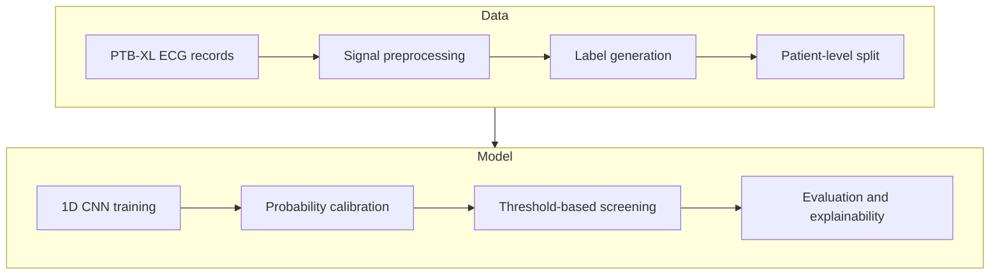
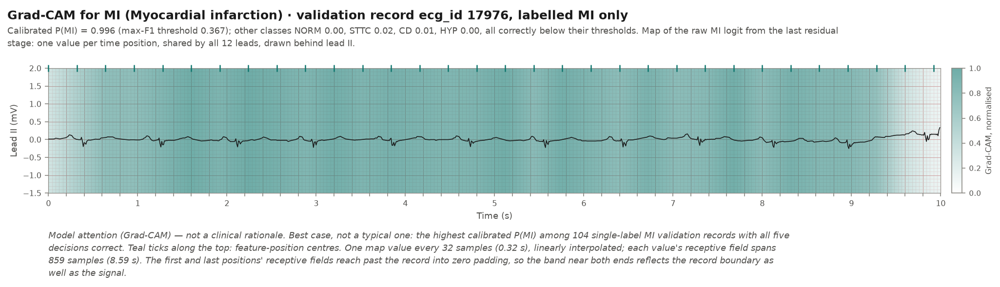

# CardioScreen: 12-lead ECG abnormality screening with a 1D CNN

> **Screening aid. Not a diagnostic device. Not for clinical use.**
> This is an educational course project. Its outputs must not be used for any medical decision.

CardioScreen takes a 10-second, 12-lead electrocardiogram (ECG) and estimates, for each of five
diagnostic categories, the probability that the category is present: normal ECG, myocardial
infarction, ST/T-wave change, conduction disturbance and hypertrophy. The model is a
one-dimensional convolutional neural network (1D CNN) trained on the public PTB-XL dataset.

An ECG records the heart's electrical activity along 12 directions at once, called **leads**. Each
lead is sampled 100 times per second (100 Hz). The project was built for CSET343 (AI in Healthcare);
the build specification is [PROJECT_SPEC.md](PROJECT_SPEC.md), and every setting lives in
[config/default.yaml](config/default.yaml).

| At a glance | |
|---|---|
| Input | One ECG record: 12 leads × 10 s at 100 Hz (12 × 1000 samples) |
| Output | Five calibrated probabilities ([NORM, MI, STTC, CD, HYP](#what-does-the-model-predict)) and a yes/no flag for each |
| Model | 1D ResNet, about 6.3 million parameters |
| Data | PTB-XL 1.0.3: 21,388 labelled records from 18,617 patients, split by patient |
| Validation result | Macro AUROC 0.929, macro AUPRC 0.816 (seed 42; three-seed mean 0.928 and 0.815). Feature baseline: 0.856 and 0.693. Scale 0 to 1, higher is better ([how to read them](#how-to-read-the-metrics)) |
| Test result | **Fold 10, evaluated once on 2026-10-19** with the frozen model, calibration and thresholds: macro AUROC 0.926 [0.918, 0.933], macro AUPRC 0.819 [0.802, 0.833] (95% patient-bootstrap intervals). See [reports/TEST_RUN.md](reports/TEST_RUN.md) |

### Project status

| Part | Status |
|---|---|
| Data pipeline, baselines, model training | Done |
| Calibration and screening thresholds (validation) | Done |
| Grad-CAM explanations and their sanity check (validation) | Done |
| Band-pass filter comparison (a filter that removes slow drift and fast noise) | Implemented, not yet measured |
| Error analysis (validation) | Done: [reports/error_analysis.md](reports/error_analysis.md) |
| Final test evaluation (`reports/metrics.json`) | Done once, 2026-10-19 (tag `v1.0-model`): [reports/TEST_RUN.md](reports/TEST_RUN.md) |
| FastAPI backend and React frontend | Not implemented yet (placeholder files only) |

**Jump to:** [Installation](#installation-and-setup) · [Data](#downloading-and-preparing-the-data) ·
[Training](#training-the-model) · [Results](#results-validation-only) ·
[Limitations](#reproducibility-and-limitations) · [Detailed docs](#where-to-find-the-details)

## What does the model predict?

PTB-XL groups its diagnostic statements into five superclasses:

| Code | Meaning | Share of validation records |
|---|---|---:|
| NORM | Normal ECG | 44.5% |
| MI | Myocardial infarction (damage to heart muscle from a blocked blood supply) | 25.2% |
| STTC | ST-segment and T-wave changes | 24.6% |
| CD | Conduction disturbance (abnormal spread of the heart's electrical signal) | 23.1% |
| HYP | Hypertrophy (thickened heart muscle) | 12.5% |

**One record can have several labels.** About one in four labelled records has two or more
superclasses, for example MI and CD together. So this is a *multi-label* task, not a
*multi-class* one: the model answers five separate yes/no questions instead of choosing exactly one
class. Each output has its own sigmoid, and there is no softmax.

**From model output to decision.** Three different quantities appear in this project:

| Quantity | What it is |
|---|---|
| Raw logit | The network's unbounded score for a class. Higher means "more likely" |
| Calibrated probability | The logit, corrected so that it matches observed frequencies better (see [calibration](#calibration-and-screening-thresholds)) |
| Flag | Yes or no: is the calibrated probability at or above that class's threshold? |

**What a probability means.** Calibration aims to make "0.8 for MI" mean "about 80% of such records
have MI". That holds on average on the validation records it was fitted to, but has not been checked
on held-out data or other populations. It describes this model on PTB-XL, not a patient's clinical
risk.

## How does the project work?



1. **ECG records.** PTB-XL provides 21,799 clinical 12-lead ECGs, each 10 seconds long.
2. **Signal preprocessing.** Each record is read once into a 12 × 1000 array and cached. Each lead is
   later z-scored (rescaled to mean 0 and standard deviation 1) with statistics from the training
   split only.
3. **Label generation.** Each record's diagnostic statements are mapped to the five superclasses.
4. **Patient-level split.** All records of a patient go to the same split, so the model is never
   tested on a patient it has seen.
5. **1D CNN training.** A residual 1D CNN learns from the training split; the validation split picks
   the best epoch.
6. **Probability calibration.** A small per-class correction brings the predicted probabilities
   closer to the observed frequencies.
7. **Threshold-based screening.** Each class gets its own probability threshold for raising a flag.
8. **Evaluation and explainability.** Metrics, reliability diagrams and Grad-CAM maps, all on the
   validation split so far.

### Where to find the details

This README gives the overview. The technical details, with every number traced to a report, are in
`docs/`:

| Document | Contents |
|---|---|
| [docs/DATA_PIPELINE.md](docs/DATA_PIPELINE.md) | Download checks, labels, splits, cache, normalisation, augmentation, test-set lock |
| [docs/MODEL_AND_TRAINING.md](docs/MODEL_AND_TRAINING.md) | Architecture, loss, schedule, run records, reproducibility, training curves |
| [docs/EXPERIMENTS_AND_RESULTS.md](docs/EXPERIMENTS_AND_RESULTS.md) | Baselines, beat detector, full results, amplitude-scaling experiment |
| [docs/CALIBRATION_AND_EVALUATION.md](docs/CALIBRATION_AND_EVALUATION.md) | Metric definitions, calibration, operating points, fresh-clone evaluation |
| [docs/EXPLAINABILITY.md](docs/EXPLAINABILITY.md) | Grad-CAM method, randomisation check, example maps and their limits |

## Technologies used

| Technology | Used for |
|---|---|
| Python 3.11 | Everything below |
| PyTorch 2.14.1 | The 1D CNN, training, Grad-CAM |
| NumPy, pandas | Signal arrays and record metadata |
| wfdb | Reading PTB-XL's record files (WFDB, PhysioNet's waveform format) |
| SciPy | Band-pass filters, the beat detector, skewness and kurtosis, rank correlation |
| scikit-learn | The gradient-boosting baseline; AUROC and AUPRC |
| matplotlib | All figures in `reports/figures/` |
| PyYAML | The configuration file |
| requests, tqdm | Downloading the dataset with progress bars |
| pytest | The test suite |

FastAPI, pydantic, uvicorn and python-multipart are pinned in `requirements.txt` for the planned
backend but are not used yet. The planned frontend (React, Vite, TypeScript, Tailwind) has not been
set up.

## Dataset

**PTB-XL** is a large public dataset of clinical 12-lead ECGs recorded in Germany, published on
PhysioNet. This project uses **version 1.0.3** and only the **100 Hz** versions of the records.

| | Records | Patients |
|---|---:|---:|
| Whole dataset | 21,799 | 18,869 |
| With at least one diagnostic superclass (used here) | 21,388 | 18,617 |

- **Signals.** 10 s × 12 leads at 100 Hz: 1000 samples per lead, in millivolts.
- **Labels.** Each record comes with standardised diagnostic statements (SCP-ECG codes, in the
  `scp_codes` column). Those marked diagnostic in `scp_statements.csv` are mapped to their
  superclass. This reproduces PhysioNet's published class counts exactly.
- **Excluded records.** 411 records have only rhythm or form statements (mostly pacemaker, atrial
  fibrillation and flutter) and no diagnostic superclass, so they are dropped.

**Splits.** PTB-XL's `strat_fold` column divides patients into 10 folds:

| Split | Folds | Records | Patients | Used for |
|---|---|---:|---:|---|
| Train | 1–8 | 17,084 | 14,823 | Fitting the model and the normalisation statistics |
| Validation | 9 | 2,146 | 1,917 | Choosing the epoch, settings, calibration and thresholds |
| Test | 10 | 2,158 | 1,877 | The one-time final evaluation (not run yet) |

**Why patient-level splitting matters.** Some patients have several ECGs. If one were in training
and another in validation, the model could recognise the patient instead of the disease, and the
scores would be too optimistic. An automated check confirms that no patient appears in two splits,
and a software lock stops code from loading the test split by accident.

**Licence.** PTB-XL is released under the Creative Commons Attribution 4.0 International licence
(CC BY 4.0). The data is not stored in this repository; see
[References and licence](#references-and-licence) for the required citations.

More detail: [docs/DATA_PIPELINE.md](docs/DATA_PIPELINE.md).

## Model architecture

The model is a 1D residual network (ResNet), defined in
[src/models/resnet1d.py](src/models/resnet1d.py).

**Why a 1D CNN?** An ECG is a set of time series. A 1D convolution slides small learned filters
along time across all 12 leads at once. In principle, early filters can respond to short shapes such
as a QRS complex, and deeper layers can combine them into longer patterns such as a widened QRS.
Because the same filters are applied at every position, a pattern can be detected roughly wherever
it occurs. (This is the design intent; the learned filters were not inspected.)

**Why residual connections?** Each residual block adds its input (or a resized copy of it) back to
its output, so the block only has to learn a correction. This keeps training stable in a deep
network (He et al., 2016).

| Part | What it does | Output (channels × time) |
|---|---|---|
| Stem | Convolution (kernel 7, stride 2), batch normalisation, ReLU, max pooling | 64 × 250 |
| Stage 1 | 2 residual blocks | 64 × 250 |
| Stage 2 | 2 residual blocks, halves the time axis | 128 × 125 |
| Stage 3 | 2 residual blocks, halves the time axis | 256 × 63 |
| Stage 4 | 2 residual blocks, halves the time axis | 512 × 32 |
| Head | Global average pooling over time, dropout, linear layer | 5 logits |

Terms: the kernel is the filter width in samples; stride 2 halves the time axis; batch normalisation
rescales intermediate values; ReLU sets negative values to 0; max pooling keeps the largest value in
each small window.

**From features to predictions.** Global average pooling turns the 512 × 32 feature map into one
512-number summary of the record. A linear layer maps it to five **logits** (unbounded scores), and
a sigmoid per class turns each logit into a probability. The model has **6,290,821 trainable
parameters**.

More detail: [docs/MODEL_AND_TRAINING.md](docs/MODEL_AND_TRAINING.md).

## Training methodology

| Choice | Value | Why |
|---|---|---|
| Training data | Folds 1–8 | Patient-level split |
| Normalisation | Per-lead z-score, statistics from the training split only | Using all data would leak information from validation and test |
| Augmentation (training only) | Time shift up to ±2 s; Gaussian noise (σ = 0.05 lead std) | More variety without changing the diagnosis |
| Loss | `BCEWithLogitsLoss` with `pos_weight` per class (negatives ÷ positives: 1.25 for NORM up to 7.06 for HYP) | One yes/no loss per class; `pos_weight` counters class imbalance |
| Optimiser | AdamW, learning rate 1e-3, weight decay 1e-2 | Standard choice; weight decay limits overfitting |
| Learning-rate schedule | Linear warmup over the first 2 epochs, then cosine decay to zero at epoch 50 | Gentle start, smaller steps later |
| Batch size | 64 | Fits a 4 GB GPU |
| Model selection | Best validation macro AUROC; stop after 8 epochs without improvement | Keeps the best epoch, stops when overfitting starts |
| Seed | 42, with deterministic GPU kernels | Repeatable runs |

- **Augmentation choices.** Time reversal and sign inversion are never used, because they change
  the clinical meaning of an ECG. Amplitude scaling (×0.8–1.2) is implemented but switched off: it
  did not improve HYP AUPRC under the project's decision rule (see the
  [amplitude-scaling experiment](#amplitude-scaling-experiment)).
- **Reproducibility.** Repeating a full run with the same code, config and seed on the same machine
  gave bit-identical weights.
- **Sanity check.** Before the full run, the model is shown to memorise 50 training records, which
  catches gross errors such as wrong targets or a broken update step.

More detail: [docs/MODEL_AND_TRAINING.md](docs/MODEL_AND_TRAINING.md).

## Results (validation only)

> All results in this section are on the **validation split** (fold 9), **not** the test split. Because
> the epoch, settings, calibration and thresholds were chosen on this split, the numbers are optimistic.
> The one-time test result (fold 10) is in [reports/TEST_RUN.md](reports/TEST_RUN.md). The model has
> not been validated for clinical use.

### How to read the metrics

- **AUROC** (area under the receiver operating characteristic curve) measures how well the model
  *ranks* records: the chance that a random record with the class scores higher than a random record
  without it. 0.5 is guessing and 1.0 is perfect.
- **AUPRC** (area under the precision–recall curve, computed as average precision) summarises the
  balance between precision and recall over all thresholds. It is more informative than AUROC for
  rare classes.
- **Precision** is the share of flagged records that really have the class. **Recall** (also called
  **sensitivity**) is the share of records with the class that get flagged. **Specificity** is the
  share of records without the class that are not flagged.
- **Compare AUPRC with prevalence.** A model with no skill gets an AUPRC equal to the class's
  prevalence (its share of positive records), not 0.5. For example, HYP is present in 12.5% of
  validation records, so an AUPRC of 0.67 for HYP is more than five times the no-skill level.
- **Macro** means the unweighted average over the five classes.

### Model comparison

| Model | Macro AUROC | Macro AUPRC |
|---|---:|---:|
| Prior baseline (always predicts the training frequency) | 0.500 | 0.260 |
| Feature baseline (79 hand-crafted features + gradient boosting) | 0.856 | 0.693 |
| **1D ResNet** (committed config, seed 42) | **0.929** | **0.816** |

| Class | Prevalence | Feature AUROC | Feature AUPRC | ResNet AUROC | ResNet AUPRC |
|---|---:|---:|---:|---:|---:|
| NORM | 0.445 | 0.889 | 0.856 | 0.947 | 0.931 |
| MI | 0.252 | 0.828 | 0.637 | 0.930 | 0.843 |
| STTC | 0.246 | 0.828 | 0.602 | 0.930 | 0.789 |
| CD | 0.231 | 0.850 | 0.742 | 0.928 | 0.847 |
| HYP | 0.125 | 0.886 | 0.628 | 0.909 | 0.671 |

- The CNN beats the feature baseline in every class. The gain is smallest for HYP (AUROC +0.02,
  AUPRC +0.04); the reason has not been established.
- Across three seeds (42, 43, 44), the committed config reaches macro AUROC **0.928 ± 0.001** and
  macro AUPRC **0.815 ± 0.003** (mean ± standard deviation).
- For context, Strodthoff et al. (2021) report about 0.93 macro AUROC for the best CNNs on this
  task, but on the test fold, so the numbers are not directly comparable.

### Amplitude-scaling experiment

Random amplitude scaling was tested by training pairs of runs that differ only in that setting,
with three seeds each. The rule was: keep scaling off unless scaling on gives the higher mean HYP
AUPRC.

| Metric (fold 9, mean ± std over 3 seeds) | Scaling on | Scaling off | Off better in |
|---|---:|---:|---:|
| HYP AUPRC | 0.6574 ± 0.0051 | 0.6688 ± 0.0030 | 3 of 3 seeds |
| HYP AUROC | 0.9042 ± 0.0027 | 0.9068 ± 0.0031 | 2 of 3 seeds |
| CD AUPRC | 0.8582 ± 0.0047 | 0.8525 ± 0.0084 | 0 of 3 seeds |
| CD AUROC | 0.9327 ± 0.0018 | 0.9300 ± 0.0014 | 0 of 3 seeds |
| Macro AUROC | 0.9270 ± 0.0003 | 0.9279 ± 0.0009 | 3 of 3 seeds |
| Macro AUPRC | 0.8121 ± 0.0006 | 0.8148 ± 0.0027 | 2 of 3 seeds |

- **Decision:** scaling stays off, because scaling on does not give the higher mean HYP AUPRC.
- **Trade-off:** scaling off raises HYP AUPRC but lowers CD in every seed; the HYP AUROC difference
  is within noise. A plausible, untested reason: hypertrophy criteria depend on absolute voltage,
  which scaling blurs, while conduction disturbances depend on timing.
- **Uncertainty:** three seeds are few; three out of three agreeing would happen by chance one time
  in four. For each seed, a 95% interval was estimated by resampling validation patients; only one
  seed's interval for the HYP AUPRC difference excludes zero, and only just.
- **History:** scaling was first switched off after the seed-42 pair alone, so the evaluated seed-42
  model is the better of two runs on fold 9, which adds a little optimism.

All 12 metrics and per-seed differences:
[docs/EXPERIMENTS_AND_RESULTS.md](docs/EXPERIMENTS_AND_RESULTS.md#5-amplitude-scaling-experiment).
Every bootstrap interval:
[reports/runs/summary_amplitude_scale_seeds.json](reports/runs/summary_amplitude_scale_seeds.json).

## Calibration and screening thresholds

**Why calibrate?** The raw outputs overstate every class. Training up-weighted positive labels
(`pos_weight`), which shifts every logit upwards, and the saved model is somewhat overconfident.
Calibration is a small per-class correction fitted on the validation split after training.

| Method | Formula | What it can fix |
|---|---|---|
| Temperature scaling | p = sigmoid(logit / T) | Overconfidence only |
| Platt scaling | p = sigmoid(a · logit + b) | Overconfidence (through a) and the upward shift (through b) |

Per class, the method with the lower expected calibration error (ECE: the average gap between
predicted probability and observed frequency) is kept. Platt scaling won for MI, STTC, CD and HYP,
and temperature scaling for NORM. Macro ECE fell from 0.089 to 0.016. Calibration never changes the
order of records, so AUROC and AUPRC are unchanged.

**From probability to flag.** A record is flagged for a class when its calibrated probability is at
least that class's threshold. Thresholds are chosen per class rather than shared, because the classes
differ in prevalence and in how the model's scores are spread. A threshold is an operating choice
for this model, not a universal medical cut-off.

Two operating points are reported:

- **Max-F1:** the threshold with the best F1 score, which balances precision and sensitivity.
- **Sensitivity ≥ 0.90:** for each abnormal class, the strictest threshold that still catches at
  least 90% of validation cases. The project's spec treats a missed abnormality as costlier than a
  false alarm; the right balance would depend on a clinical setting this project does not address.

Max-F1 operating point:

| Class | Threshold | Sensitivity | Specificity | Precision |
|---|---:|---:|---:|---:|
| NORM | 0.415 | 0.919 | 0.845 | 0.826 |
| MI | 0.367 | 0.793 | 0.903 | 0.734 |
| STTC | 0.373 | 0.807 | 0.897 | 0.718 |
| CD | 0.357 | 0.786 | 0.924 | 0.755 |
| HYP | 0.396 | 0.578 | 0.959 | 0.668 |

Sensitivity ≥ 0.90 operating point (abnormal classes only):

| Class | Threshold | Sensitivity | Specificity | Precision |
|---|---:|---:|---:|---:|
| MI | 0.181 | 0.900 | 0.801 | 0.604 |
| STTC | 0.219 | 0.902 | 0.807 | 0.604 |
| CD | 0.132 | 0.901 | 0.780 | 0.551 |
| HYP | 0.073 | 0.903 | 0.721 | 0.316 |

The max-F1 thresholds are similar across classes (0.36–0.42); the high-sensitivity thresholds
differ much more (0.07–0.22).

**High sensitivity means more false alarms.** At the max-F1 threshold the model misses 42% of HYP
cases. Raising HYP sensitivity to 0.90 cuts the misses from 113 to 26 of 268, but false alarms rise
from 77 to 524 of the 1,878 records without HYP, so only about one in three HYP flags is correct.

> **These operating points are optimistic.** Calibration and thresholds were chosen on the same
> validation records they are scored on. The unbiased estimate comes from applying the frozen
> calibration and thresholds once to the test split: see [reports/TEST_RUN.md](reports/TEST_RUN.md).

More detail: [docs/CALIBRATION_AND_EVALUATION.md](docs/CALIBRATION_AND_EVALUATION.md).

## Explainability (Grad-CAM)

**Grad-CAM** (gradient-weighted class activation mapping) highlights *when* in the 10-second record
the model's internal features pushed the score for one class up. It is drawn as a shaded band behind
the ECG trace: darker means that part of the record raised that class's score more, relative to the
rest of the same record.



*A best case, not a typical one: the most confident correctly classified MI-only validation record.*

**What the band can show.** Roughly which time regions (one value every 0.32 s) contributed most to
one class's score.

**What it cannot show.**

- Which lead mattered: the map is shared by all 12 leads.
- Which beat or wave mattered: each value draws on a window up to 8.6 s wide.
- Evidence *against* the class, or a comparison of strength between records.
- That the model learned correct medical reasoning.

> **The heatmap is model attention, not a clinical rationale.**

**Sanity check.** If the maps barely changed when the trained weights were replaced with random
ones, they would only reflect the input signal. For one validation record per class, the trained and
random-model maps shared little: mean |Spearman ρ| (rank correlation) about 0.2, against a pass limit
of 0.5. The check passed.

The evidence is limited. It uses 5 records; 3 of the 15 random maps were empty and were left out by a
rule added after the first run; one pair reached ρ = 0.60; and the limit bounds the average, not
each record.

More detail: [docs/EXPLAINABILITY.md](docs/EXPLAINABILITY.md).

## Installation and setup

You need **Python 3.11** and Git. An NVIDIA GPU with CUDA is recommended for training; the reported
results came from a 4 GB laptop GPU.

Only step 1 differs between operating systems. From step 2 on, the same commands work in Windows
PowerShell and in a Linux or macOS shell, except the optional `bash scripts/...` helper scripts.

### 0. Get the code

Clone the repository with Git, then work inside its folder. A ZIP download will not work: every
report records the git commit, and the commands stop with an error outside a git repository.

```bash
git clone https://github.com/uttkarsh-thakur26/ecg-screening.git
```

```bash
cd ecg-screening
```

### 1. Create and activate a virtual environment

A virtual environment keeps this project's packages separate from the rest of your system. Run these
commands from the repository folder.

Windows (PowerShell):

```powershell
py -3.11 -m venv .venv
.\.venv\Scripts\Activate.ps1
```

If PowerShell says that running scripts is disabled, allow scripts for the current window only and
then run the activation line again:

```powershell
Set-ExecutionPolicy -Scope Process -ExecutionPolicy RemoteSigned
```

Linux or macOS:

```bash
python3.11 -m venv .venv
source .venv/bin/activate
```

### 2. Install the dependencies

`requirements.txt` pins the exact versions behind the reported results. It installs PyTorch 2.14.1
built for CUDA 12.6 from PyTorch's own package index; this build also runs on a CPU.

```bash
python -m pip install --upgrade pip
pip install -r requirements.txt
```

The CUDA 12.6 build needs a recent NVIDIA driver (version 560 or newer). For another CUDA version, or
on macOS: delete the `--extra-index-url` and `torch==` lines from `requirements.txt`, install torch
2.14.1 with the command [pytorch.org](https://pytorch.org/get-started/locally/) gives for your system,
then run `pip install -r requirements.txt` again.

### 3. Check that PyTorch sees the GPU

```bash
python -c "import torch; print(torch.cuda.is_available())"
```

It prints `True` when a CUDA GPU is usable. If it prints `False` on a machine with an NVIDIA GPU,
check that `nvidia-smi` lists the GPU and that the driver supports CUDA 12.6.

### 4. Only without an NVIDIA GPU: use the CPU

Training and evaluation use `training.device: cuda` by default and stop with a clear error if no GPU
is visible, rather than silently using the CPU. To use the CPU, change that line in
[config/default.yaml](config/default.yaml):

```yaml
training:
  device: cpu
```

- This one change covers every command, including the overfit check, evaluation and Grad-CAM. For a
  full training run alone, `--set training.device=cpu` also works; the other commands have no `--set`.
- Editing this tracked file makes every report record `dirty: true`, and most commands print a
  warning. Commit the change before training if you want clean records; `summarize_comparisons`
  refuses runs trained from a dirty tree.
- CPU training is much slower; its run time has not been measured.
- Skip the GPU test in the test suite by adding `--ignore=tests/test_cuda.py` (see
  [step 6 of data preparation](#downloading-and-preparing-the-data)).
- Deterministic kernels make runs repeatable on one machine, not identical across GPUs or on the
  CPU, so a CPU model will be close to the committed results but not identical.

## Downloading and preparing the data

The download is about 551 MB: 43,600 data files plus PhysioNet's checksum list. Preparing the data
adds a signal cache of about 1.05 GB, so allow at least 2 GB of free disk space. Everything is
written to `data/`, which git ignores.

**1. Download the dataset.**

```bash
python -m src.data.download
```

Downloads PTB-XL 1.0.3 from PhysioNet's AWS Open Data mirror into `data/raw/` and checks every file
against PhysioNet's published SHA-256 checksums. It can be interrupted and re-run: finished files
are kept and partial ones are resumed. It ends with the record and patient counts (21,799 and 18,869)
and `Matches PhysioNet's figures for PTB-XL v1.0.3`.

**2. Verify the files.**

```bash
python -m src.data.download --verify-only
```

Works offline. Checks the counts and that every record's `.hea` and `.dat` file exists, and prints
the same four lines as the end of step 1. It does not re-hash files; `--rehash` does.

**3. Inspect a sample ECG.**

```bash
python -m src.data.inspect_record
```

Loads one training record (`ecg_id` 1), prints its shape `(1000, 12)`, sampling rate (100 Hz) and
lead names, and saves lead II on ECG-paper scale to `reports/figures/sample_record.png`.

**4. Prepare labels, splits, normalisation statistics and the cache.**

```bash
python -m src.data.prepare
```

Prints the label table (21,388 records kept, 411 dropped, class counts matching PhysioNet's) and the
split table, then `Patient leakage check passed`. It builds the signal cache in `data/cache/raw/` if
it is missing, then computes the training-only normalisation statistics and saves `norm_stats.json`.

**5. Inspect the data-loading pipeline.**

```bash
python -m src.data.inspect_pipeline
```

Prints one batch from the training and validation loaders (signals `(64, 12, 1000)`, targets
`(64, 5)`), shows that the test loader is locked, and times how long one training epoch takes to
load. To check the shapes it also loads one test batch through the lock's explicit override; no
model sees it. Use `--workers 0 2 4` to compare worker counts.

**6. Run the tests.**

```bash
python -m pytest --deselect tests/test_calibration.py::test_calibration_recomputed_from_the_checkpoint_leaves_auroc_unchanged
```

All tests should pass. The deselected test re-predicts with the checkpoint named by
`evaluation.model_run`, so it can only pass after you have [trained a model](#training-the-model),
set `evaluation.model_run` to its run id and run [calibration](#evaluation-and-explainability-commands).

Without a GPU, skip the GPU test as well:

```bash
python -m pytest --ignore=tests/test_cuda.py --deselect tests/test_calibration.py::test_calibration_recomputed_from_the_checkpoint_leaves_auroc_unchanged
```

## Training the model

> **Model weights are not in git.** The `checkpoints/` folder is ignored, so a fresh clone has no
> trained model. Train your own before running any evaluation or Grad-CAM command.

**1a. Check the GPU.** This test confirms that the GPU is visible and computes correctly. It fails
(rather than skips) without a GPU, so leave it out on a CPU-only machine.

```bash
python -m pytest tests/test_cuda.py
```

**1b. Print the model summary.** This prints the output shape and parameter count of the stem, the
four stages and the head, and the total of 6,290,821 parameters, without loading any data.

```bash
python -m src.models.resnet1d
```

**2. Fit the baselines (optional).**

```bash
python -m src.models.baselines
```

Fits the prior and feature baselines on the training split, scores them on validation, and writes
`reports/baselines_val.json`. Training prints its results next to these for comparison.

**3. Run the overfit sanity check.**

```bash
python -m src.training.train --overfit
```

Trains on 50 records for 300 steps. It should print `Overfit check PASSED: eval-mode loss ...` and
exit with status 0. The 300 steps took about 13 s on the 4 GB laptop GPU used for the reported
results.

**4. Train the main model.**

```bash
python -m src.training.train --name main
```

Trains on folds 1–8 with early stopping on fold 9. A full run took about 5 minutes on a 4 GB laptop
GPU. It prints a table per epoch and ends with the best epoch, a comparison with the baselines and
the saved file paths. The run id (`<date>-<time>_main`) is printed at the start.

A new `main` run uses today's config and should be close to the evaluated model; the older committed
run named `main` differs (see [committed runs](docs/MODEL_AND_TRAINING.md#11-committed-runs)).

**5. Compare experiments (optional).** Each `--set KEY=VALUE` overrides one existing config value for
a single run, keeping its type; repeat the flag for several (`splits.*` cannot be changed). For
example, this trains seed 43 with amplitude scaling switched on:

```bash
python -m src.training.train --name on-s43 --set training.seed=43 --set augmentation.amplitude_scale.enabled=true
```

This compares two finished runs on the validation split, with a bootstrap over patients, and writes
`reports/runs/compare_<A>_vs_<B>.json`. It needs both runs' checkpoints, so on a fresh clone it
works only for runs you trained yourself:

```bash
python -m src.training.compare_runs <run A id> <run B id>
```

`python -m src.training.summarize_comparisons --name <name> <compare json> ...` then combines
comparisons made with different seeds into mean ± standard deviation
([details](docs/EXPERIMENTS_AND_RESULTS.md#5-amplitude-scaling-experiment)).

**Where the outputs go.**

| Output | Location | Tracked by git |
|---|---|---|
| Best weights of each run | `checkpoints/<run_id>/best.pt` | no (ignored) |
| Per-epoch log | `reports/runs/<run_id>.csv` | yes |
| Run record (config, commit, seed, environment, best epoch) | `reports/runs/<run_id>.json` | yes |
| Run comparisons | `reports/runs/compare_*.json`, `reports/runs/summary_*.json` | yes |

`bash scripts/run_training.sh` runs steps 1a, 3 and 4 in one go and stops at the first failure. It
needs a GPU and a bash shell (on Windows, Git Bash or WSL); otherwise run the three steps one by
one.

## Evaluation and explainability commands

Every command in this section scores the **validation split only** (the training split is read
just to draw the class-distribution figure). None of them opens the test split.

**On a fresh clone, first point the config at your model.** Set `evaluation.model_run` in
[config/default.yaml](config/default.yaml) to the run id from training. The committed value names a
run whose weights exist only on the machine that trained it. Editing this tracked file makes the
commands print a dirty-tree warning and record `dirty: true`; commit the change first if you want
clean records.

**1. Calibrate and evaluate.**

```bash
python -m src.training.calibrate
```

Reloads the best checkpoint, checks that its predictions reproduce the logged validation metrics,
fits the calibrators, chooses the thresholds, and writes `reports/calibration.json`,
`reports/thresholds.json`, `reports/metrics_val.json` and the figures in `reports/figures/`.

**2. Re-run only the evaluation (optional).**

```bash
python -m src.evaluation.evaluate_val
```

Regenerates thresholds, metrics and figures from the saved `reports/calibration.json` without
refitting it.

**3. Compute the Grad-CAM maps.**

```bash
python -m src.explain.gradcam_val
```

Runs the randomisation sanity check and draws the example overlays. Writes `reports/gradcam_val.json`
and the `gradcam_*` figures. Needs the calibration and thresholds from step 1 for the same run.

- These commands **overwrite** the committed reports with your model's numbers, which will be close
  to but not identical with the committed ones.
- Each command also accepts `--run <run_id>` for a one-off run, but then the tests that compare the
  saved reports with `evaluation.model_run` will fail.

**Final test evaluation: done once.** `scripts/run_eval.sh` (`python -m src.evaluation.evaluate_test`)
ran the plan committed in [reports/TEST_PLAN.md](reports/TEST_PLAN.md) on fold 10 and wrote
`reports/metrics.json`. It refuses to open fold 10 again: every opening is recorded in
`reports/fold10_access_log.jsonl`, and a rerun is only allowed after a documented bug fix in the
evaluation code. `--rehearse <folder>` runs the same pipeline on fold 9 only.

## Project structure

```text
ecg-screening/
├── config/default.yaml      # every setting and hyperparameter
├── docs/                    # detailed documentation
├── src/
│   ├── data/                # download, labels, splits, cache, normalisation, augmentation, test lock
│   ├── models/              # resnet1d.py, baselines.py, rpeak_check.py
│   ├── training/            # train.py, calibrate.py, compare_runs.py, summarize_comparisons.py
│   ├── evaluation/          # metrics, thresholds, calibration, plots, evaluate_val.py; error_analysis.py (placeholder)
│   ├── explain/             # gradcam1d.py, gradcam_val.py, figures.py
│   ├── api/                 # FastAPI backend (placeholder, not implemented)
│   ├── config.py            # loads the config
│   └── provenance.py        # records the git commit in every report
├── tests/                   # pytest suite
├── reports/
│   ├── *.json               # validation reports: baselines, calibration, thresholds, metrics, Grad-CAM
│   ├── figures/             # all figures
│   └── runs/                # one CSV and one JSON per training run, plus run comparisons
├── scripts/                 # run_training.sh; run_eval.sh (the one-time test evaluation)
├── frontend/                # planned React app (placeholder, not set up)
├── data/                    # PTB-XL download and cache (created locally, not in git)
├── checkpoints/             # trained weights (created locally, not in git)
├── PROJECT_SPEC.md          # build specification
└── requirements.txt         # pinned Python dependencies
```

Every number and figure in `reports/` is written by a script; nothing in it is typed in by hand.

## Reproducibility and limitations

**Reproducibility.**

- All settings are in one config file, and every run records its effective config, git commit, seed
  and software environment.
- A fixed seed and deterministic GPU kernels give bit-identical runs on the same machine; this was
  checked on a full training run.
- Results differ slightly across GPUs, on the CPU, and with a different number of data-loading
  workers.
- Each report records the git commit it came from and whether the tree had uncommitted changes. All
  training runs and validation reports come from clean commits; only the three-seed summary
  (`reports/runs/summary_amplitude_scale_seeds.json`) was generated while its own script was still
  uncommitted.

**Evaluation status.** The test split (fold 10) was never used to train, tune or select anything. It
was scored once, on 2026-10-19, with the frozen model, calibration and thresholds, following a plan
committed beforehand ([reports/TEST_PLAN.md](reports/TEST_PLAN.md)): macro AUROC 0.926 [0.918, 0.933], macro AUPRC 0.819 [0.802, 0.833] (95% patient-bootstrap intervals). Results and the
comparison with validation are in [reports/TEST_RUN.md](reports/TEST_RUN.md).

**Limitations.**

- **Not for medical use.** This is a course project. It has no regulatory approval, no clinical
  validation and no prospective or external testing, and it must not inform any medical decision.
- **One dataset.** PTB-XL is a single public dataset collected in Germany. Results may not hold for
  other hospitals, recording devices or populations.
- **Class imbalance.** HYP is present in only 12.5% of validation records and is the hardest class
  (AUPRC 0.67). At the max-F1 threshold the model misses 42% of validation HYP cases.
- **False negatives and false positives.** Every threshold trades one for the other. On the
  validation records used to pick the high-sensitivity thresholds, about one in ten abnormal records
  is still missed and many flags are false alarms; on new data more cases are likely to be missed.
- **Probabilities are not clinical risk.** Calibration was fitted on PTB-XL validation data and is
  only meaningful for similar data.
- **Grad-CAM is not an explanation.** The maps show model attention at a resolution of about a third
  of a second and do not prove that the model uses medically correct features.
- **Small experiments.** The amplitude-scaling decision rests on three seeds.
- **Not yet done:** the band-pass filter comparison.

## References and licence

### Dataset

PTB-XL is released by PhysioNet under the **Creative Commons Attribution 4.0 International (CC BY
4.0)** licence. Use of the data requires attribution. Cite the dataset and its paper:

- Wagner, P., Strodthoff, N., Bousseljot, R., Samek, W., & Schaeffter, T. (2022). *PTB-XL, a large
  publicly available electrocardiography dataset* (version 1.0.3). PhysioNet.
  https://doi.org/10.13026/kfzx-aw45
- Wagner, P., Strodthoff, N., Bousseljot, R.-D., Kreiseler, D., Lunze, F. I., Samek, W., &
  Schaeffter, T. (2020). PTB-XL, a large publicly available electrocardiography dataset.
  *Scientific Data*, 7, 154. https://doi.org/10.1038/s41597-020-0495-6

PhysioNet also asks for its standard citation. The PTB-XL page currently gives:

- Pollard, T., Moody, B. E., Lehman, L., Gow, B., Fernandes, C., Xie, C., Johnson, A., Mark, R. G., &
  Heldt, T. (2026). PhysioNet as a global platform for biomedical research. *Nature Health*.
  https://doi.org/10.1038/s44360-026-00096-z

PhysioNet's earlier standard citation:

- Goldberger, A., et al. (2000). PhysioBank, PhysioToolkit, and PhysioNet: Components of a new
  research resource for complex physiologic signals. *Circulation*, 101(23), e215–e220.

### Methods

- He, K., Zhang, X., Ren, S., & Sun, J. (2016). Deep residual learning for image recognition.
  *CVPR 2016*, 770–778.
- Ribeiro, A. H., et al. (2020). Automatic diagnosis of the 12-lead ECG using a deep neural network.
  *Nature Communications*, 11, 1760.
- Strodthoff, N., Wagner, P., Schaeffter, T., & Samek, W. (2021). Deep learning for ECG analysis:
  Benchmarks and insights from PTB-XL. *IEEE Journal of Biomedical and Health Informatics*, 25(5),
  1519–1528.
- Pan, J., & Tompkins, W. J. (1985). A real-time QRS detection algorithm. *IEEE Transactions on
  Biomedical Engineering*, BME-32(3), 230–236.
- Guo, C., Pleiss, G., Sun, Y., & Weinberger, K. Q. (2017). On calibration of modern neural
  networks. *ICML 2017*.
- Platt, J. (1999). Probabilistic outputs for support vector machines and comparisons to regularized
  likelihood methods. In *Advances in Large Margin Classifiers*. MIT Press.
- Zhou, B., Khosla, A., Lapedriza, A., Oliva, A., & Torralba, A. (2016). Learning deep features for
  discriminative localization. *CVPR 2016*, 2921–2929.
- Selvaraju, R. R., et al. (2017). Grad-CAM: Visual explanations from deep networks via
  gradient-based localization. *ICCV 2017*, 618–626.
- Adebayo, J., et al. (2018). Sanity checks for saliency maps. *NeurIPS 2018*.
- Luo, W., Li, Y., Urtasun, R., & Zemel, R. (2016). Understanding the effective receptive field in
  deep convolutional neural networks. *NeurIPS 2016*.

### Code

This repository does not yet include a licence file for its own code.
