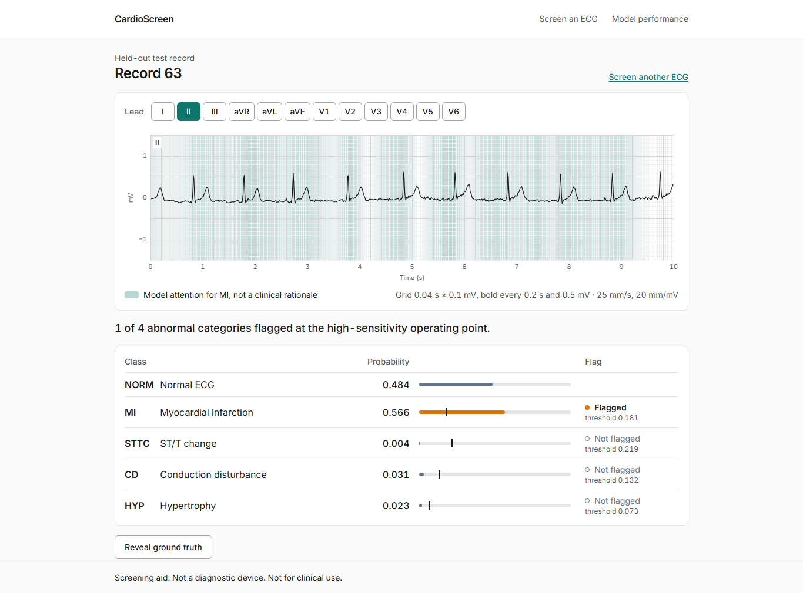

# CardioScreen: 12-lead ECG abnormality screening with a 1D CNN

> **Screening aid. Not a diagnostic device. Not for clinical use.**
> This is an educational course project (CSET343, AI in Healthcare). Its outputs must not be used for
> any medical decision.

## What it does

An **electrocardiogram (ECG)** records the heart's electrical activity. A standard ECG looks at the
heart from 12 directions at once, called **leads**, for 10 seconds. Reading thousands of them takes a
cardiologist's time, and a missed abnormality is costly.

CardioScreen reads one 12-lead ECG and answers five yes/no questions: is the ECG **normal**, and does
it show signs of **myocardial infarction** (heart-muscle damage from a blocked artery), **ST/T
change**, **conduction disturbance** (the electrical signal spreads abnormally) or **hypertrophy**
(thickened heart muscle)? For each it gives a probability, and it **flags** an abnormal category when
the probability reaches a threshold chosen to catch about 9 in 10 cases. One ECG can show several
abnormalities, so several flags can be raised at once.



*The Result screen for test record 63. The model flags myocardial infarction (MI), which is also the
record's label in the dataset. The green band shows where in the 10 seconds the model's evidence for
MI was strongest; it is model attention, not a clinical rationale.*

The app has three screens:

1. **Screen an ECG**: pick one of the 2,158 held-out test records, or upload your own record as a
   `.hea` + `.dat` pair (WFDB, PhysioNet's waveform format).
2. **Result**: the signal on a clinical ECG grid (any of the 12 leads), the attention band when a
   category is flagged, and the probability, threshold and flag for each category. For a test record,
   **Reveal ground truth** then shows the dataset's labels next to the model's flags.
3. **Model performance**: the one-time test-set evaluation, every number read from
   `reports/metrics.json`.

The model is a one-dimensional convolutional neural network (1D CNN, a ResNet with about 6.3 million
parameters) trained on **PTB-XL**, a public dataset of 21,799 clinical ECGs. It runs on a laptop GPU
or on the CPU, entirely offline.

## Results on the held-out test set

The test set is **PTB-XL fold 10**, held out from every decision. It was **evaluated once**, on
2026-10-19, with the model, calibration and thresholds frozen on the validation fold beforehand. The
evaluation followed a plan **pre-registered in [reports/TEST_PLAN.md](reports/TEST_PLAN.md)**,
committed before fold 10 was opened; every opening of fold 10 is logged in
`reports/fold10_access_log.jsonl` (one entry, no reruns). The tables below are written from
`reports/metrics.json` by `python -m src.evaluation.doc_tables`, and a test fails if they ever differ
from it.

<!-- metrics:test-results:start -->
PTB-XL 1.0.3, fold 10: 2,158 records from 1,877 patients, evaluated once on 2026-10-19 at commit `d1e1b42`. Brackets are 95% intervals: percentile bootstrap over patients, 1,000 resamples.

**Ranking** (threshold-free: does a record with the class score higher than one without it?)

| Class | Prevalence | AUROC | AUPRC |
|---|---:|---:|---:|
| NORM (Normal ECG) | 0.446 | 0.947 [0.938, 0.955] | 0.929 [0.914, 0.942] |
| MI (Myocardial infarction) | 0.255 | 0.922 [0.908, 0.934] | 0.819 [0.788, 0.847] |
| STTC (ST/T change) | 0.241 | 0.937 [0.925, 0.947] | 0.834 [0.800, 0.864] |
| CD (Conduction disturbance) | 0.230 | 0.922 [0.905, 0.939] | 0.841 [0.808, 0.869] |
| HYP (Hypertrophy) | 0.121 | 0.901 [0.880, 0.921] | 0.670 [0.611, 0.718] |
| **Macro, all 5 classes** |  | 0.926 [0.918, 0.933] | 0.819 [0.802, 0.833] |
| **Macro, 4 abnormal classes** |  | 0.921 [0.912, 0.928] | 0.791 [0.771, 0.808] |

**High-sensitivity operating point** (the thresholds the app uses; chosen on fold 9 for sensitivity ≥ 0.90). Missed cases: MI 62 of 550, STTC 51 of 521, CD 55 of 496, HYP 29 of 262.

| Class | Threshold | Sensitivity | Specificity | Precision | F1 |
|---|---:|---:|---:|---:|---:|
| MI (Myocardial infarction) | 0.181 | 0.887 [0.859, 0.914] | 0.786 [0.763, 0.806] | 0.587 [0.551, 0.620] | 0.706 [0.676, 0.732] |
| STTC (ST/T change) | 0.219 | 0.902 [0.874, 0.927] | 0.811 [0.789, 0.831] | 0.603 [0.565, 0.638] | 0.723 [0.691, 0.749] |
| CD (Conduction disturbance) | 0.132 | 0.889 [0.861, 0.916] | 0.792 [0.772, 0.812] | 0.560 [0.524, 0.597] | 0.687 [0.655, 0.717] |
| HYP (Hypertrophy) | 0.073 | 0.889 [0.848, 0.929] | 0.713 [0.688, 0.733] | 0.299 [0.265, 0.331] | 0.448 [0.407, 0.484] |
| **Macro, 4 abnormal classes** |  | 0.892 [0.876, 0.907] | 0.775 [0.763, 0.787] | 0.512 [0.496, 0.528] | 0.641 [0.626, 0.655] |

**Against the baselines**

| Model (macro, all 5 classes) | AUROC | AUPRC |
|---|---:|---:|
| Prior baseline (every record scored with the training-split class frequency) | 0.500 | 0.259 |
| Feature baseline (hand-crafted RR-interval and amplitude features, gradient-boosted trees) | 0.839 [0.827, 0.850] | 0.676 [0.654, 0.696] |
| **1D CNN (this model)** | 0.926 [0.918, 0.933] | 0.819 [0.802, 0.833] |
| CNN minus feature baseline (paired: same resampled patients) | +0.086 [0.077, 0.097] | +0.142 [0.126, 0.161] |

**Calibration**: expected calibration error (ECE, 10 equal-width bins; lower is better). Point values: ECE's bootstrap interval is biased upward and is not a confidence interval, so it is not shown.

| Class | Calibrator (fitted on fold 9) | ECE uncalibrated | ECE calibrated |
|---|---|---:|---:|
| NORM (Normal ECG) | Temperature scaling | 0.036 | 0.016 |
| MI (Myocardial infarction) | Platt scaling | 0.082 | 0.015 |
| STTC (ST/T change) | Platt scaling | 0.109 | 0.012 |
| CD (Conduction disturbance) | Platt scaling | 0.107 | 0.016 |
| HYP (Hypertrophy) | Platt scaling | 0.113 | 0.014 |
| **Macro, all 5 classes** |  | 0.089 | 0.015 |
<!-- metrics:test-results:end -->

**How to read these.** AUROC is the chance that a random record with the class scores higher than a
random record without it (0.5 is guessing, 1 is perfect). AUPRC summarises precision against
sensitivity over all thresholds; with no skill it equals the class's prevalence, not 0.5, so compare
it with the prevalence column. **Sensitivity** is the share of records with the class that get
flagged, **specificity** the share without it that are not flagged, and **precision** the share of
flags that are correct. **Macro** is the unweighted average over classes.

The full test report, including the max-F1 operating point and the comparison with the validation
fold, is [reports/TEST_RUN.md](reports/TEST_RUN.md).

## Setup on Windows, from a clean clone

Everything below runs in **Windows PowerShell** from the repository folder. It was checked by cloning
the repository into an empty folder and following this section step by step.

### What you need

| | |
|---|---|
| Windows 10 or 11 | PowerShell (built in) |
| [Git](https://git-scm.com/download/win) | to clone the repository |
| [Python 3.11](https://www.python.org/downloads/) | with the `py` launcher (the installer's default) |
| [Node.js 24](https://nodejs.org/) | includes `npm`; only for the app's frontend |
| Disk space | about 6 GB: the Python environment 4.5 GB (mostly PyTorch with CUDA), the dataset 0.5 GB, its cache 1 GB, the frontend's packages 0.1 GB |
| NVIDIA GPU (optional) | with driver 560 or newer for CUDA 12.6. Without one, everything runs on the CPU (see [Running on the CPU](#running-on-the-cpu)) |

### 1. Clone the repository

Use Git, not a ZIP download: every report records the git commit it came from, and the scripts stop
with an error outside a git repository.

```powershell
git clone https://github.com/uttkarsh-thakur26/ecg-screening.git
cd ecg-screening
```

The clone includes the frozen release model, `checkpoints/release.pt` (25 MB). It is the only model
file in git; the API checks its SHA-256 against `reports/release.json` before serving it.

### 2. Create the Python environment

```powershell
py -3.11 -m venv .venv
.\.venv\Scripts\Activate.ps1
python -m pip install --upgrade pip
pip install -r requirements.txt
```

If PowerShell says that running scripts is disabled, allow them for this window only, then run the
activation line again:

```powershell
Set-ExecutionPolicy -Scope Process -ExecutionPolicy RemoteSigned
```

`requirements.txt` pins every version behind the reported results, including **PyTorch 2.14.1 built
for CUDA 12.6** from PyTorch's own package index. The same build also runs on a computer without a
GPU. Check what PyTorch sees:

```powershell
python -c "import torch; print(torch.__version__, torch.cuda.is_available())"
```

It prints `2.14.1+cu126 True` when a CUDA GPU is usable. `False` on a machine with an NVIDIA GPU
means the driver is missing or too old for CUDA 12.6 (`nvidia-smi` should list the GPU).

### 3. Download and prepare the data

The data is **not stored in this repository**. A script downloads PTB-XL 1.0.3 (about 551 MB, 43,600
files) from PhysioNet's AWS Open Data mirror into `data/raw/` and checks every file against
PhysioNet's published SHA-256 checksums. It can be interrupted and run again: finished files are kept
and partial ones resumed.

```powershell
python -m src.data.download
```

It ends with the record and patient counts (21,799 and 18,869) and
`Matches PhysioNet's figures for PTB-XL v1.0.3`.

**Already downloaded it once?** For example in another clone of this project: copy that clone's
`data\raw` folder into this one, then run the download script with `--rehash`. It re-checks every
copied file against PhysioNet's checksums and downloads only what is missing or wrong:

```powershell
Copy-Item -Recurse <path to the other clone>\data\raw data\raw
python -m src.data.download --rehash
```

Then build the labels, splits, normalisation statistics and the signal cache (about 1.05 GB in
`data/cache/`):

```powershell
python -m src.data.prepare
```

It prints the label table (21,388 records kept, 411 without a diagnostic label dropped) and the split
table, then `Patient leakage check passed`.

### 4. Run the tests

```powershell
python -m pytest
```

Every test should pass: 397 tests, about 2.5 minutes with a laptop GPU. On a computer without a CUDA
GPU, leave out the GPU test: `python -m pytest --ignore=tests/test_cuda.py`. The tests that re-predict
the validation fold use the committed release model where the training run's own checkpoint is not
present (it is a byte copy, pinned by the same SHA-256).

### 5. Run the app

Two PowerShell windows, both in the repository folder. In the first, with the environment active:

```powershell
python -m src.api.main
```

It loads and checks the release model and serves it on `http://127.0.0.1:8000`; it is ready when it
logs `Application startup complete`. In the second:

```powershell
cd frontend
npm ci
npm run dev
```

Then open **http://localhost:5173**. `npm ci` needs the internet once; after that the app works fully
offline (the font is bundled, and nothing is fetched from a CDN). The address of the API and the one
browser origin it accepts are set in `api.host`, `api.port` and `api.cors_origins` in
[config/default.yaml](config/default.yaml).

### Running on the CPU

Without a GPU, the API refuses to start rather than silently switching device. Set this in
[config/default.yaml](config/default.yaml):

```yaml
api:
  device: cpu
```

The CPU gives the same flags as the GPU: for test records 9, 63 and 38 every flag and attention class
is the same, and the calibrated probabilities differ by at most 0.00006. Serving one record is about as
fast as on the GPU (about 10 ms for the prediction and 10 ms for the attention map on an 8-core laptop
CPU). For training and the evaluation scripts, set `training.device: cpu` the same way (CPU training is
much slower and gives a close but not identical model).

### 6. Reproduce training

```powershell
python -m pytest tests/test_cuda.py        # the GPU is visible and computes correctly
python -m src.training.train --overfit     # sanity check: memorises 50 records, prints "Overfit check PASSED"
python -m src.training.train --name main   # the full run: folds 1-8, early stopping on fold 9
```

A full run takes about 5 minutes on a 4 GB laptop GPU. It writes the weights to
`checkpoints/<run id>/best.pt` (not committed) and the per-epoch log and run record to
`reports/runs/`. `python -m src.models.baselines` fits the two baselines. With the same code, config,
seed and GPU, a run is bit-for-bit repeatable: retrained from a fresh clone on the laptop that trained
the release model, the run stopped at the same epoch (19 of 27) with weights bit-identical to
`checkpoints/release.pt`. On other hardware it is close but not identical.

### 7. Reproduce the evaluation

The **validation** evaluation (calibration, thresholds, figures, Grad-CAM) can be re-run on your own
model. Set `evaluation.model_run` in [config/default.yaml](config/default.yaml) to your run id (printed
at the start of training), then:

```powershell
python -m src.training.calibrate      # calibrators, thresholds, validation metrics and figures
python -m src.explain.gradcam_val     # Grad-CAM maps and the randomisation check
```

These overwrite the committed validation reports with your model's numbers. The **test** evaluation
(`python -m src.evaluation.evaluate_test`) has been run once and refuses to open fold 10 again: the
access log already has its one entry, and a rerun is allowed only after a documented bug fix in the
evaluation code. Its fold-9 rehearsal (`--rehearse <folder>`) re-checks the three seed runs behind the
seed-stability numbers from their own checkpoints, which are not committed, so it runs only on the
machine that trained them.

## Methods

### Data and patient-wise splits

PTB-XL 1.0.3 has 21,799 ten-second, 12-lead ECGs from 18,869 patients, here at 100 samples per
second (12 × 1000 values per record). Each record's diagnostic statements are mapped to five
superclasses: NORM, MI, STTC, CD and HYP. 411 records with no diagnostic statement are dropped,
leaving 21,388 records from 18,617 patients.

**Splits are by patient**, using the dataset's own `strat_fold` column: folds 1–8 train the model
(17,084 records), fold 9 chooses everything that is tuned (2,146 records), and fold 10 is the test
set (2,158 records from 1,877 patients). All records of a patient sit in one fold, so the model is
never scored on a patient it has seen; a test asserts that no patient appears in two splits, and a
software lock stops code from loading fold 10 by accident. Signals are z-scored per lead with
statistics from the training folds only.

### Model and training

A 1D ResNet: a convolutional stem, four stages of two residual blocks (64 to 512 channels, halving
the time axis three times), global average pooling and a linear layer with **one output per class**.
Each output has its own sigmoid; there is no softmax, because the classes are not mutually exclusive.

| Choice | Value |
|---|---|
| Loss | `BCEWithLogitsLoss` with a per-class **`pos_weight`** = negatives ÷ positives in the training folds (1.25 for NORM up to 7.06 for HYP), so rare classes are not ignored |
| Optimiser | AdamW, learning rate 1e-3, weight decay 1e-2; 2-epoch warm-up, then cosine decay |
| Batch size | 64 (fits a 4 GB GPU) |
| Augmentation (training only) | time shift up to ±2 s and Gaussian noise. Never time reversal or sign flips, which change an ECG's meaning |
| Model selection | best fold-9 macro AUROC; stop after 8 epochs without improvement |
| Seed | 42, with deterministic GPU kernels |

Every setting lives in [config/default.yaml](config/default.yaml); every run records its effective
config, git commit, seed and software environment.

### Calibration: Platt scaling, and why temperature alone failed

`pos_weight` makes the network's raw probabilities overstate every class: for a record whose true
chance of a class is *q*, the weighted loss is lowest at a logit of `logit(q) + log(pos_weight)`, an
upward **offset** that is largest for the rarest class. The chosen epoch is also slightly
**overconfident** (logits too large). Two per-class calibrators were fitted on fold 9:

- **Temperature scaling**, `sigmoid(logit / T)`, can only shrink or stretch the logits; a logit of 0
  always stays at probability 0.5, so it cannot remove an offset. On fold 9 it made the expected
  calibration error (ECE) of all four abnormal classes **worse**, for example MI from 0.078 to 0.089 and
  HYP from 0.109 to 0.124: shrinking every logit lifted the many low-scoring records towards 0.5.
- **Platt scaling**, `sigmoid(a · logit + b)`, adds a bias. Its fitted `b` was negative for every
  class and grew with `pos_weight` (MI −0.94 up to HYP −1.49), exactly the offset the argument above
  predicts, and its slopes `a` of 0.62–0.74 removed the overconfidence. Fold-9 macro ECE fell from
  0.089 to 0.016.

Per class, the calibrator with the lower fold-9 ECE was kept: Platt for MI, STTC, CD and HYP,
temperature for NORM (where the two were within 0.0002). Both are strictly increasing, so AUROC and
AUPRC do not change. On the test set the calibrated macro ECE is 0.015 (table above).

### Operating points

A class is flagged when its calibrated probability reaches that class's threshold, chosen on fold 9.
The app uses the **high-sensitivity point**: for each abnormal class, the strictest threshold that
still flagged at least 90% of fold-9 cases, because the project treats a missed abnormality as costlier
than a false alarm. NORM gets a probability but no flag. A second, **max-F1** point (best balance of
precision and sensitivity) is reported in [reports/TEST_RUN.md](reports/TEST_RUN.md).

### The amplitude-scaling ablation

Random amplitude scaling (multiplying a record by 0.8–1.2 during training) was tested with pairs of
runs that differ only in that setting, three seeds each, on fold 9. The rule fixed beforehand: keep
it off unless it gives the higher mean HYP AUPRC.

| Fold 9, mean ± std over 3 seeds | Scaling on | Scaling off | Off better in |
|---|---:|---:|---:|
| HYP AUPRC | 0.6574 ± 0.0051 | 0.6688 ± 0.0030 | 3 of 3 seeds |
| CD AUPRC | 0.8582 ± 0.0047 | 0.8525 ± 0.0084 | 0 of 3 seeds |
| Macro AUROC | 0.9270 ± 0.0003 | 0.9279 ± 0.0009 | 3 of 3 seeds |

Scaling stays **off**. It trades HYP for CD: a plausible, untested reason is that hypertrophy criteria
depend on absolute voltage, which scaling blurs, while conduction disturbances depend on timing. Three
seeds are few, and only one seed's bootstrap interval for the HYP difference excludes zero. Details:
[docs/EXPERIMENTS_AND_RESULTS.md](docs/EXPERIMENTS_AND_RESULTS.md#5-amplitude-scaling-experiment).

### Grad-CAM and its randomisation check

The attention band is **Grad-CAM** adapted to 1D: the gradients of one class's logit weight the
feature maps of the last residual stage, which are then interpolated back to the 1000 samples. The
map has one value every 0.32 s, each drawing on a window of up to 8.6 s, and it is shared by all 12
leads. The app computes it for the most probable abnormal class and shows it only when at least one
category is flagged.

**Randomisation check** (Adebayo et al., 2018): if the maps barely changed when the trained weights
were replaced with random ones, they would reflect only the input signal. For one fold-9 record per
class, trained and random-model maps shared little (mean |Spearman ρ| about 0.2, against a pass limit
of 0.5), so the check passed. The evidence is limited: 5 records, 3 of the 15 random maps were empty
and left out by a rule added after the first run, and one pair reached ρ = 0.60. Details:
[docs/EXPLAINABILITY.md](docs/EXPLAINABILITY.md).

## Error analysis

From the 10 most confident misses and 10 most confident false alarms on the **validation fold** at
the high-sensitivity point ([reports/error_analysis.md](reports/error_analysis.md)):

- **The misses are uncertain labels and rarer sub-types, not noisy recordings.** Only 1 of the 10 has
  a signal-quality note in PTB-XL (against 31% of all validation records). All three missed MIs rest on
  a single MI statement of likelihood 15; across the fold such MI labels are missed 24% of the time
  (27 of 114), against 5% (14 of 283) at likelihood 100.
- **Common sub-types are learned better than rare ones.** Left-ventricular hypertrophy is missed in 5%
  of HYP cases (11 of 210), atrial enlargement in 21–40%; non-specific intraventricular conduction
  delay causes 27 of the 49 CD misses.
- **False alarms usually carry another abnormality.** 7 of the 10 confident false alarms are ST/T
  flags, and 6 of those 7 records carry LVH or MI statements, conditions that themselves change the ST
  segment and T wave. Every abnormal class is flagged 1.8 to 3.5 times as often on records with another
  abnormality as on normal records.

So the main error sources are label uncertainty and overlap between PTB-XL's superclasses, not signal
quality: a clinician reviewing a confident false alarm would usually find a real abnormality with a
different label.

## Limitations

The same list as on the app's Model performance screen:

- Single dataset (PTB-XL 1.0.3) from one source; results may not hold for other hospitals or devices.
- No external or prospective validation.
- Hypertrophy is the weakest class (lowest test AUPRC and AUROC): at the high-sensitivity point about 7 in 10 HYP flags are false alarms (545 of 778 flags on the test set).
- Many missed cases have uncertain labels (low likelihood in PTB-XL), most clearly for myocardial infarction. This comes from the error analysis on the validation split, not from the test set.
- Attention maps show where the model responded, not a clinical reason; they are shared across leads and coarse in time, so they cannot point to a single beat or wave.
- Screening aid, not a diagnostic device.

## Dataset, licence and citation

**PTB-XL, version 1.0.3**, published on PhysioNet under the **Creative Commons Attribution 4.0
International (CC BY 4.0)** licence. It is **not stored in this repository**: `python -m
src.data.download` fetches it and checks it against PhysioNet's checksums (`data/` is git-ignored).
Cite the dataset and its paper:

- Wagner, P., Strodthoff, N., Bousseljot, R.-D., Kreiseler, D., Lunze, F. I., Samek, W., &
  Schaeffter, T. (2020). PTB-XL, a large publicly available electrocardiography dataset.
  *Scientific Data*, 7, 154. https://doi.org/10.1038/s41597-020-0495-6
- Wagner, P., Strodthoff, N., Bousseljot, R., Samek, W., & Schaeffter, T. (2022). *PTB-XL, a large
  publicly available electrocardiography dataset* (version 1.0.3). PhysioNet.
  https://doi.org/10.13026/kfzx-aw45
- PhysioNet's standard citation: Goldberger, A., et al. (2000). PhysioBank, PhysioToolkit, and
  PhysioNet: Components of a new research resource for complex physiologic signals. *Circulation*,
  101(23), e215–e220.

The committed model weights (`checkpoints/release.pt`) were trained on PTB-XL and are shared under the
same attribution.

## The app's API

`python -m src.api.main` serves the frozen release model. At startup it checks `release.pt`,
`reports/calibration.json` and `reports/thresholds.json` against the SHA-256 values in
`reports/release.json`, and that `reports/metrics.json` was computed with them; if anything differs it
stops with an error. Without `metrics.json` it still serves predictions and answers 404 on the two
metrics endpoints, and the Model performance screen shows an empty state.

| Endpoint | Returns |
|---|---|
| `GET /api/health` | Status and model version |
| `GET /api/records` | The ids of the 2,158 held-out test records. No labels, no patient data |
| `GET /api/records/{id}/signal` | The record's 12 leads × 1000 samples in mV |
| `POST /api/predict` | JSON `{"record_id": "<id>"}`, or a form upload with files `hea` and `dat` |
| `GET /api/records/{id}/truth` | The record's labels, only after it was predicted (409 before) |
| `GET /api/metrics` | `reports/metrics.json`, byte for byte |
| `GET /api/figures/{name}` | A test-set figure listed in `metrics.json`, as PNG |

Uploads must be 12-lead WFDB records in mV, exactly 10 s long, at a whole-number sampling rate (other
rates are resampled to 100 Hz); anything else is refused with a 400 and the reason. Requests are
capped at 1 MiB and uploaded files are deleted when the request ends.

Frontend checks, in `frontend/`: `npm test` (unit tests, no network), `npm run test:contract` (the
client against the running API), `npm run typecheck`, `npm run lint`, `npm run build`.

## Project structure

```text
ecg-screening/
├── config/default.yaml      # every setting and hyperparameter
├── src/
│   ├── data/                # download, labels, patient-wise splits, cache, normalisation, augmentation, test lock
│   ├── models/              # resnet1d.py (the CNN), baselines.py
│   ├── training/            # train.py, calibrate.py, run comparisons
│   ├── evaluation/          # metrics, thresholds, calibration, plots, error analysis, release freeze,
│   │                        # evaluate_test.py (the one-time test run), doc_tables.py (this README's tables)
│   ├── explain/             # Grad-CAM 1D and its randomisation check
│   └── api/                 # FastAPI backend
├── frontend/                # React + TypeScript + Tailwind app (three screens)
├── tests/                   # pytest suite, including the patient-leakage test (tests/test_splits.py)
├── reports/                 # every number and figure, written by scripts; metrics.json is the test result
├── checkpoints/release.pt   # the frozen release model (the only committed weights)
├── docs/                    # detailed documentation
├── DEMO.md                  # the live-demo script
└── PROJECT_SPEC.md          # the build specification
```

Detailed documentation, with every number traced to a report:

| Document | Contents |
|---|---|
| [docs/DATA_PIPELINE.md](docs/DATA_PIPELINE.md) | Download checks, labels, splits, cache, normalisation, augmentation, test-set lock |
| [docs/MODEL_AND_TRAINING.md](docs/MODEL_AND_TRAINING.md) | Architecture, loss, schedule, run records, reproducibility, training curves |
| [docs/EXPERIMENTS_AND_RESULTS.md](docs/EXPERIMENTS_AND_RESULTS.md) | Baselines, full validation results, amplitude-scaling experiment |
| [docs/CALIBRATION_AND_EVALUATION.md](docs/CALIBRATION_AND_EVALUATION.md) | Metric definitions, calibration, operating points |
| [docs/EXPLAINABILITY.md](docs/EXPLAINABILITY.md) | Grad-CAM method, randomisation check, example maps and their limits |
| [reports/TEST_PLAN.md](reports/TEST_PLAN.md), [reports/TEST_RUN.md](reports/TEST_RUN.md) | The pre-registered test plan and the one-time test run |

## References

- He, K., Zhang, X., Ren, S., & Sun, J. (2016). Deep residual learning for image recognition.
  *CVPR 2016*, 770–778.
- Strodthoff, N., Wagner, P., Schaeffter, T., & Samek, W. (2021). Deep learning for ECG analysis:
  Benchmarks and insights from PTB-XL. *IEEE Journal of Biomedical and Health Informatics*, 25(5),
  1519–1528.
- Guo, C., Pleiss, G., Sun, Y., & Weinberger, K. Q. (2017). On calibration of modern neural
  networks. *ICML 2017*.
- Platt, J. (1999). Probabilistic outputs for support vector machines and comparisons to regularized
  likelihood methods. In *Advances in Large Margin Classifiers*. MIT Press.
- Selvaraju, R. R., et al. (2017). Grad-CAM: Visual explanations from deep networks via
  gradient-based localization. *ICCV 2017*, 618–626.
- Adebayo, J., et al. (2018). Sanity checks for saliency maps. *NeurIPS 2018*.

This repository does not yet include a licence file for its own code.
