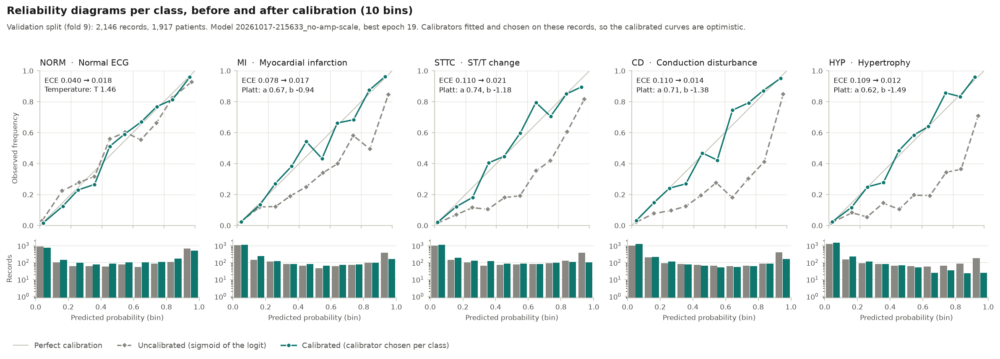

# Calibration and evaluation (validation only)

> Educational course project. Screening aid, not a diagnostic device. Not for clinical use: the
> probabilities, flags and thresholds here must not inform any medical decision.

This document explains how the trained model's outputs become calibrated probabilities and
screening decisions, and how they are scored. For a short overview, see the
[README](../README.md#calibration-and-screening-thresholds).

> **Everything here uses the validation split (fold 9: 2,146 records, 1,917 patients).** The
> calibrators and the thresholds were fitted, chosen and scored on these same records, so the
> calibrated and thresholded numbers are optimistic. The unbiased estimate will come from applying
> the frozen calibrators and thresholds once to the test split (fold 10). That was done once, on
> 2026-10-19: see section 9 and [reports/TEST_RUN.md](../reports/TEST_RUN.md).

## 1. What is evaluated

- **Model:** the best checkpoint of run `20261017-215633_no-amp-scale` (seed 42, committed config,
  best epoch 19), named by `evaluation.model_run` in the config.
- **Reproduction check:** every command reloads the checkpoint, predicts fold 9 with deterministic
  kernels and checks that the predictions reproduce the macro AUROC and AUPRC the training run
  logged (to within 1e-6). If they do not, the command stops with an error.
- **Commands:** `python -m src.training.calibrate` fits the calibrators and then runs the whole
  evaluation. `python -m src.evaluation.evaluate_val` runs only the evaluation half, reusing the
  saved `reports/calibration.json`.

## 2. From logits to decisions

The model's output goes through three distinct stages. They must not be mixed up.

| Stage | What it is | Where it comes from |
|---|---|---|
| **Raw logit** | Any real number, one per class. Higher means "more likely" | The model's last linear layer |
| **Calibrated probability** | A number in [0, 1] that is meant to match the observed frequency | `sigmoid(a · logit + b)`, with `a` and `b` per class from `reports/calibration.json` |
| **Flag** | Yes or no for one class | Calibrated probability ≥ that class's threshold from `reports/thresholds.json` |

The thresholds in `thresholds.json` are only valid for calibrated probabilities. The file names
the calibration file and its SHA-256, and must never be applied to raw sigmoid outputs.

## 3. Metrics

Each class is scored as its own binary problem (one-vs-rest), because the task is multi-label.
The definitions follow [`src/evaluation/metrics.py`](../src/evaluation/metrics.py).

At a threshold, every record falls into one of four groups for a class: true positives (TP, flagged
and has the finding), false positives (FP, flagged but does not), false negatives (FN, not flagged
but has it) and true negatives (TN, not flagged and does not).

| Metric | Definition | Plain meaning |
|---|---|---|
| AUROC | Probability that a random positive scores above a random negative (ties count half) | Ranking quality; 0.5 is guessing |
| AUPRC | Average precision (scikit-learn `average_precision_score`) | Precision over all recall levels; a no-skill model scores the prevalence |
| Sensitivity (recall) | TP / (TP + FN) | Share of records *with* the finding that are flagged |
| Specificity | TN / (TN + FP) | Share of records *without* the finding that are not flagged |
| Precision (positive predictive value, PPV) | TP / (TP + FP) | Share of flagged records that really have the finding |
| NPV (negative predictive value) | TN / (TN + FN) | Share of unflagged records that really lack it |
| F1 | 2TP / (2TP + FP + FN) | Balance of precision and sensitivity |
| ECE | See section 5 | Average gap between predicted probability and observed frequency |

- **Accuracy is not reported.** With HYP in 12% of validation records, a model that never flags HYP
  is 88% accurate on it and useless.
- **Two kinds of macro average appear.** "Macro" over all five classes is used for ranking metrics
  (macro AUROC 0.929). "Macro, abnormal" averages the four abnormal classes only (MI, STTC, CD, HYP)
  and is used for operating points, because NORM has no high-sensitivity threshold.

## 4. Why the raw outputs need calibration

A probability is **calibrated** when it means what it says: of the records given about 0.8 for a
class, about 80% have it. The raw sigmoid outputs of this model are not, for two reasons.

**1. `pos_weight` shifts every logit upwards.** Training weighted each positive label of class *c*
by `pos_weight` = negatives ÷ positives (HYP 7.06, NORM 1.25). Write `logit(q) = log(q / (1 − q))`
for the logit that corresponds to a probability *q*. For a record whose true chance of having the
class is *q*, the weighted loss is lowest at a logit of `logit(q) + log(pos_weight)` rather than
`logit(q)`. So every raw probability overstates its class, the rare classes most.

**2. The logits are overconfident.** The saved epoch sits at the onset of overfitting: validation
loss rises after it ([training curves](MODEL_AND_TRAINING.md#9-training-curves)). The fitted Platt
slopes below (a = 0.62–0.74, below 1) confirm that the logits are too large in size.

## 5. Two calibrators, chosen per class by ECE

[`src/training/calibrate.py`](../src/training/calibrate.py) fits two calibrators per class to the
fold-9 logits *z*. Each minimises the mean binary cross-entropy **without** `pos_weight`, using
L-BFGS (a standard quasi-Newton optimiser) started from the identity.

| Calibrator | Formula | Can fix overconfidence | Can fix the `pos_weight` shift |
|---|---|---|---|
| Temperature scaling | p = sigmoid(z / T) | yes | no: z = 0 always stays at p = 0.5 |
| Platt scaling | p = sigmoid(a · z + b) | yes, through a | yes, through the bias b |

If the `pos_weight` shift were the only distortion, Platt scaling would find a = 1 and
b = −log(pos_weight).

**Expected calibration error (ECE).** Split the probabilities into 10 equal-width bins
([0, 0.1), [0.1, 0.2), ..., [0.9, 1.0]). In each bin compare the mean predicted probability with
the observed frequency of the class. ECE is the average of these gaps, weighted by the number of
records in each bin. 0 is perfect.

**Selection.** Per class, the calibrator with the lower validation ECE is kept; on an exact tie,
temperature scaling (fewer parameters). The fit stops with an error rather than saving a bad
calibrator if it does not converge, if a Platt slope `a` is not positive, or if calibration would
reorder any records.

### Results

| Class | `pos_weight` | ECE uncalibrated | Temperature: T | ECE | Platt: a | b | −log(`pos_weight`) | ECE | Chosen |
|---|---:|---:|---:|---:|---:|---:|---:|---:|---|
| NORM | 1.25 | 0.040 | 1.460 | **0.018** | 0.686 | −0.070 | −0.222 | 0.019 | Temperature |
| MI | 2.90 | 0.078 | 1.472 | 0.089 | 0.672 | −0.944 | −1.065 | **0.017** | Platt |
| STTC | 3.08 | 0.110 | 1.507 | 0.117 | 0.739 | −1.178 | −1.125 | **0.021** | Platt |
| CD | 3.37 | 0.110 | 1.385 | 0.128 | 0.706 | −1.378 | −1.216 | **0.014** | Platt |
| HYP | 7.06 | 0.109 | 1.504 | 0.124 | 0.618 | −1.492 | −1.955 | **0.012** | Platt |
| **Macro** | | 0.089 | | 0.096 | | | | 0.016 | 0.016 (chosen) |

### What the results show

- **Temperature scaling alone makes the four abnormal classes worse by ECE.** It still lowers their
  cross-entropy, the quantity it is fitted to (MI 0.343 → 0.323, HYP 0.333 → 0.311). It also makes
  the top bin more honest (HYP above 0.9: predicted 0.96, observed 0.71 → 0.84).
- **Why the ECE gets worse.** Under temperature scaling every bin of these classes over-predicts, so
  their ECE is close to the average over-prediction (mean predicted probability minus prevalence).
  Shrinking every logit towards 0 (T ≈ 1.4–1.5) lifts the many low-scoring records towards 0.5 and
  raises that average (MI: from 0.076 uncalibrated to 0.089). A pure rescaling cannot remove an
  offset.
- **The bias fixes it.** Platt's fitted b is negative for every class, and its size grows with
  `pos_weight` (NORM −0.07, MI −0.94, STTC −1.18, CD −1.38, HYP −1.49), the direction the
  `pos_weight` argument predicts. b does not equal −log(`pos_weight`), because that needs a = 1.
  The fitted slopes a = 0.62–0.74 show that the logits are also overconfident, and Platt fits both
  distortions together.
- **NORM keeps temperature scaling.** Its two ECEs differ by 0.0002 (0.0183 against 0.0185), far
  below their noise, and Platt's b is small there (−0.07).
- **AUROC and AUPRC do not change.** Both calibrators are strictly increasing, so no two records
  swap order. This is checked to 1e-12 in the script and in `tests/test_calibration.py`.
- **Reliability diagrams.** Uncalibrated, the abnormal classes sit far below the diagonal: of the HYP
  records the model scored above 0.9, only 71% had HYP. After calibration every class follows the
  diagonal much more closely. The remaining gaps are mostly in the sparse middle bins, and they are
  measured on the same records the calibrators were fitted to.

### Caveats

- **These ECEs are optimistic.** The calibrators were fitted, chosen and scored on the same fold-9
  records. Platt has two parameters and includes temperature scaling as a special case, so on its
  own fitting data its cross-entropy cannot be worse. The honest ECE will come from fold 10.
- **ECE never reaches 0 on finite data.** Each bin's observed frequency is a proportion over tens to
  hundreds of records. Its standard error is several percentage points in most middle bins and up to
  about 10 points in the sparsest HYP bins (24–35 records). Even a perfectly calibrated model scores
  above zero, so the fold-10 ECE should be compared with the uncalibrated values, not with 0.

## 6. Screening thresholds (operating points)

A threshold turns a probability into a yes/no flag: a record is flagged for a class when its
calibrated probability is **at least** the threshold. The default 0.5 is arbitrary, so thresholds
are chosen per class on fold 9. The candidates are the distinct calibrated probabilities of the
validation records.

Two operating points are reported:

- **Max-F1.** Per class, the threshold with the highest validation F1. On an exact tie, the lower
  threshold wins (same F1, more sensitivity).
- **High sensitivity (≥ 0.90).** Per abnormal class (MI, STTC, CD, HYP), the highest threshold whose
  validation sensitivity is at least 0.90: the most specificity that still catches 9 in 10 cases.
  NORM gets none, because it is not an abnormality to be caught.

**Why per-class thresholds.** Thresholds are chosen per class rather than shared, because each class
has its own prevalence and its own score distribution. In practice the max-F1 thresholds end up
similar (0.36–0.42), while the high-sensitivity thresholds differ much more (0.07–0.22). These
thresholds are operating choices for this model on this data, not medical cut-offs.

Ranking metrics (threshold-free):

| Class | AUROC | AUPRC |
|---|---:|---:|
| NORM | 0.947 | 0.931 |
| MI | 0.930 | 0.843 |
| STTC | 0.930 | 0.789 |
| CD | 0.928 | 0.847 |
| HYP | 0.909 | 0.671 |
| **Macro, all five** | **0.929** | **0.816** |
| Macro, abnormal | 0.924 | 0.787 |

Max-F1 operating point:

| Class | Threshold | Sensitivity | Specificity | Precision | F1 |
|---|---:|---:|---:|---:|---:|
| NORM | 0.415 | 0.919 | 0.845 | 0.826 | 0.870 |
| MI | 0.367 | 0.793 | 0.903 | 0.734 | 0.762 |
| STTC | 0.373 | 0.807 | 0.897 | 0.718 | 0.760 |
| CD | 0.357 | 0.786 | 0.924 | 0.755 | 0.770 |
| HYP | 0.396 | 0.578 | 0.959 | 0.668 | 0.620 |
| **Macro, abnormal** | | 0.741 | 0.921 | 0.719 | 0.728 |

Sensitivity ≥ 0.90 operating point:

| Class | Threshold | Sensitivity | Specificity | Precision | F1 |
|---|---:|---:|---:|---:|---:|
| MI | 0.181 | 0.900 | 0.801 | 0.604 | 0.723 |
| STTC | 0.219 | 0.902 | 0.807 | 0.604 | 0.723 |
| CD | 0.132 | 0.901 | 0.780 | 0.551 | 0.684 |
| HYP | 0.073 | 0.903 | 0.721 | 0.316 | 0.468 |
| **Macro, abnormal** | | 0.901 | 0.777 | 0.519 | 0.650 |

"Macro, abnormal" averages MI, STTC, CD and HYP.

### The sensitivity trade-off, with HYP as the example

| HYP operating point | Threshold | Cases caught (of 268) | Cases missed | False alarms (of 1,878 without HYP) |
|---|---:|---:|---:|---:|
| Max-F1 | 0.396 | 155 | 113 (42%) | 77 |
| Sensitivity ≥ 0.90 | 0.073 | 242 | 26 (10%) | 524 |

Lowering the threshold catches more cases, but every record in the grey zone is now flagged, so
false alarms rise sharply and precision falls (HYP: 0.67 → 0.32). The project's spec assumes that,
for a screening aid, a missed abnormality costs more than a false alarm. The right balance would
depend on a clinical setting that this project does not address.

### Thresholds before calibration

The same rules applied to the uncalibrated sigmoid outputs give different threshold values:

| Class | Max-F1, uncalibrated | Max-F1, calibrated | Sens ≥ 0.90, uncalibrated | Sens ≥ 0.90, calibrated |
|---|---:|---:|---:|---:|
| NORM | 0.378 | 0.415 | – | – |
| MI | 0.645 | 0.367 | 0.302 | 0.181 |
| STTC | 0.709 | 0.373 | 0.468 | 0.219 |
| CD | 0.754 | 0.357 | 0.328 | 0.132 |
| HYP | 0.850 | 0.396 | 0.154 | 0.073 |

Because calibration keeps the order of the records, both sets flag exactly the same validation
records (this was checked, and is recorded in `thresholds.json`), so every count and metric above is
unchanged. Calibration moves the threshold values, not
the decisions on these records. The uncalibrated values are stored in `thresholds.json` for
reference only.

## 7. Figures

| Figure | Contents | Written by |
|---|---|---|
| [`reliability_val.png`](../reports/figures/reliability_val.png) | Reliability diagrams before and after calibration | `calibrate` |
| [`roc_curves_val.png`](../reports/figures/roc_curves_val.png) | Per-class ROC curves | `calibrate`, `evaluate_val` |
| [`pr_curves_val.png`](../reports/figures/pr_curves_val.png) | Per-class precision–recall curves with the operating points | `calibrate`, `evaluate_val` |
| [`confusion_max_f1_val.png`](../reports/figures/confusion_max_f1_val.png) | Per-class confusion matrices at max-F1 | `calibrate`, `evaluate_val` |
| [`confusion_high_sensitivity_val.png`](../reports/figures/confusion_high_sensitivity_val.png) | Confusion matrices at sensitivity ≥ 0.90 (abnormal classes) | `calibrate`, `evaluate_val` |
| [`training_curves.png`](../reports/figures/training_curves.png) | Loss and validation metrics per epoch | `calibrate`, `evaluate_val` |
| [`class_distribution.png`](../reports/figures/class_distribution.png) | Class support in training and validation | `calibrate`, `evaluate_val` |

## 8. Running the evaluation on a fresh clone

Model weights are not committed, so `evaluation.model_run` points at a checkpoint that exists only on
the machine that trained it. To evaluate your own model:

1. Train a run (`python -m src.training.train --name main`) and note its run id, printed at the
   start and used to name `reports/runs/<run_id>.json`.
2. Set `evaluation.model_run: <run_id>` in `config/default.yaml`.
3. Run `python -m src.training.calibrate`, then `python -m src.explain.gradcam_val`.

Notes:

- Both commands **overwrite** the committed files in `reports/` and `reports/figures/` with your
  model's numbers, which will be close to but not identical with the committed ones.
- Editing the tracked config makes the commands print a dirty-tree warning and record
  `dirty: true` in the reports. Commit the change first if you want clean records.
- Passing `--run <run_id>` instead of editing the config also works for each command, but then the
  tests that compare the saved reports with `evaluation.model_run` fail, because the reports name
  your run while the config still names the old one.
- Until a checkpoint for `evaluation.model_run` exists,
  `tests/test_calibration.py::test_calibration_recomputed_from_the_checkpoint_leaves_auroc_unchanged`
  fails, because it re-predicts fold 9 from that checkpoint.
- `evaluate_val` alone fails for a new run until `calibrate` has been run for it, because the saved
  calibration belongs to another run.

## 9. Final test evaluation (done once)

`python -m src.evaluation.evaluate_test` ran once on 2026-10-19, following
[reports/TEST_PLAN.md](../reports/TEST_PLAN.md), which was committed before fold 10 was opened. It
loaded the frozen model, calibrators and thresholds (pinned by SHA-256 in `reports/release.json`)
without refitting anything. It scored fold 10 with every metric above, with 95% patient-bootstrap
intervals, and wrote `reports/metrics.json`. Test macro AUROC 0.926 [0.918, 0.933], macro AUPRC
0.819 [0.802, 0.833]. At the high-sensitivity point, macro sensitivity was 0.892 [0.876, 0.907]; the
calibrated macro ECE was 0.015 (uncalibrated 0.089). Details and the comparison with fold 9:
[reports/TEST_RUN.md](../reports/TEST_RUN.md).

Until then, every reported number is a validation number.

## References

- Guo, C., Pleiss, G., Sun, Y., & Weinberger, K. Q. (2017). On calibration of modern neural
  networks. *ICML 2017*, PMLR 70, 1321–1330.
- Platt, J. (1999). Probabilistic outputs for support vector machines and comparisons to
  regularized likelihood methods. In *Advances in Large Margin Classifiers*, 61–74. MIT Press.
