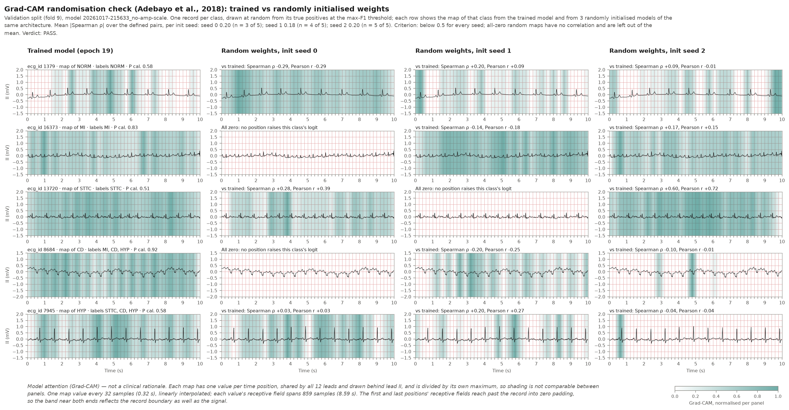

# Explainability: 1D Grad-CAM (validation only)

> Educational course project. Screening aid, not a diagnostic device. Not for clinical use.

This document explains how the project's Grad-CAM maps are computed, how they were sanity-checked
and what they can and cannot tell you. For a short overview, see the
[README](../README.md#explainability-grad-cam).

> **A Grad-CAM map is model attention, not a clinical rationale.** It does not show that the model
> learned correct medical reasoning. All maps here come from validation records (fold 9).

## 1. The idea in plain English

The model's last residual stage summarises the record as 512 feature channels at 32 time positions.
Grad-CAM (Selvaraju et al., 2017) asks: *at which of these 32 positions did the features push the
score for one class up?*

The answer is a curve over time, drawn as a shaded band behind the ECG trace. A darker band means
that part of the record raised that class's score more, relative to the rest of the same record.

## 2. Algorithm

[`src/explain/gradcam1d.py`](../src/explain/gradcam1d.py) computes the map for one class at a time:

1. A forward hook on the last residual stage captures its output A: 512 channels × 32 positions.
2. Compute the gradient of the class's **raw logit** (before sigmoid and calibration) with respect
   to A.
3. Channel weights: each channel's gradient averaged over the 32 positions.
4. CAM = ReLU(weighted sum of the channels): 32 values.
5. Interpolate linearly to the 1000 input samples.
6. Divide by the maximum, so the peak is 1 and all values lie in [0, 1].

The model must be in evaluation mode (dropout off), and the module refuses to run in training mode.

## 3. Time alignment and resolution

- **Alignment.** Every convolution and the max pool use "same" padding with odd kernel sizes, so
  feature position *j* is centred on input sample 32·*j* (0, 32, ..., 992). `feature_geometry`
  derives this from the layers, and a test checks it against the input gradient.
- **Why the interpolation is custom.** Step 5 interpolates between these centres, so the band lines
  up with the waveform. PyTorch's `F.interpolate` (with `align_corners=False`) would place position
  *j* at sample 31.25·*j* + 15.1 and misplace the band by up to 0.15 s.
- **Resolution.** The map has one value every 0.32 s.
- **Receptive field.** Each feature position "sees" a window of 859 input samples (8.6 s), the
  samples 32·*j* ± 429. In deep CNNs the samples near the centre usually carry most of the weight
  (the "effective receptive field", Luo et al., 2016), but that was not measured here.
- **Consequence.** The band shows roughly *when* in the record the evidence was strongest. It cannot
  point to one beat or one wave.
- **Edges.** Only positions 14–17 (centred between about 4.5 s and 5.4 s) have windows that lie fully
  inside the 10 s record. For the other 28 of the 32 positions the window reaches past the record
  into zero padding, increasingly towards both ends, so the band near the ends reflects the record
  boundary as well as the signal.

## 4. Why this is exact CAM

CAM (class activation mapping, Zhou et al., 2016) is the older method that Grad-CAM generalises. It
works only for networks that end in global average pooling and one linear layer, which is exactly
this model's head. Grad-CAM does not require that head, but with it Grad-CAM reduces exactly to CAM.

The head is global average pooling, then dropout (the identity in evaluation mode), then one linear
layer. So the gradient at every position is w_c / 32, and the channel weights are the classifier's
own weights for class *c*. As a result:

- the map before the ReLU sums exactly to the logit minus the classifier bias;
- it splits the logit into 32 additive shares, one per time position.

A unit test checks this identity.

## 5. Why divide by the maximum

After the ReLU, 0 means "this position did not raise the class's score": it added nothing, or it
lowered the score, and the ReLU hides which. Dividing by the peak keeps that meaning, and a nearly
flat map stays flat instead of being stretched to full contrast (as min–max scaling would do). A map
with no positive value anywhere stays all zero.

Because each map is scaled to its own peak, the shading cannot be compared between records.

## 6. Calibration does not change the map

Calibration turns the logit z into a·z + b with a > 0. The gradient is multiplied by a,
ReLU(a·s) = a·ReLU(s), interpolation is linear, and step 6 divides a out again. The bias b is a
constant with no gradient.

On the five randomisation-check records, the calibrated logit's map matched the raw logit's map to
1.3e-7 (float32 rounding), and the un-normalised peaks differed by the factor a. With a < 0 the ReLU
would keep the opposite regions, which is one reason the calibrators require a > 0.

## 7. Randomisation sanity check

**Purpose.** If a map barely changes when the trained weights are replaced with random ones, it
reflects the input rather than what the model learned (Adebayo et al., 2018).

**Method.**

- One validation record per class, drawn at random (seed 42) from that class's true positives at the
  max-F1 threshold.
- Each record's map for that class is computed by the trained model and by three randomly
  initialised models of the same architecture (initialisation seeds 0, 1 and 2).
- Similarity is measured with Spearman's rank correlation ρ (the measure Adebayo et al. report),
  with Pearson's r alongside.

**Pass criterion.** For every random model, the mean |ρ| between trained and random maps must be
below 0.5. The limit is recorded in the config (`explain.randomisation.max_mean_abs_spearman`) and,
according to its comments, was set before any map was computed. It bounds the average, not each
record.

| ecg_id | Map of | Labels | Calibrated P | Spearman ρ, seeds 0 / 1 / 2 | Pearson r, seeds 0 / 1 / 2 |
|---:|---|---|---:|---|---|
| 1379 | NORM | NORM | 0.577 | −0.29 / +0.20 / +0.09 | −0.29 / +0.09 / −0.01 |
| 16373 | MI | MI | 0.830 | all zero / −0.14 / +0.17 | all zero / −0.18 / +0.15 |
| 13720 | STTC | STTC | 0.509 | +0.28 / all zero / +0.60 | +0.39 / all zero / +0.72 |
| 8684 | CD | MI, CD, HYP | 0.920 | all zero / −0.20 / −0.10 | all zero / −0.25 / −0.01 |
| 7945 | HYP | STTC, CD, HYP | 0.581 | +0.03 / +0.20 / −0.04 | +0.03 / +0.27 / −0.04 |
| **Mean \|ρ\|, \|r\|, defined pairs** | | | | **0.20 / 0.18 / 0.20** (n = 3 / 4 / 5) | 0.24 / 0.20 / 0.19 |
| Mean, all-zero maps counted as 0 | | | | 0.12 / 0.15 / 0.20 | 0.14 / 0.16 / 0.19 |

**Verdict: PASS.** The trained and random maps share little.

- **"All zero"** means the random model has no time position that raises that class's logit, so its
  map is empty and no correlation exists. The criterion did not anticipate empty maps.
- After the first run produced 3 empty maps out of 15, an explicit rule was added to the config
  (`undefined_correlations: exclude`): leave them out of the mean. This is the stricter choice,
  because counting them as ρ = 0 can only lower the mean. The verdict is PASS under both rules.
- Seed 0's mean rests on only 3 records.
- The highest single value is record 13720 against seed 2 (ρ = 0.60). Both maps are broad with dim
  ends, although their peaks do not clearly coincide. A random network still responds to the
  waveform's own structure, and this check exposes that input-driven part of a map. On average it
  is small here.



## 8. Example overlays

For each of MI, STTC and CD, the overlay uses the validation record that has only that label, has
all five decisions correct at the max-F1 thresholds, and has the highest calibrated probability for
the class. These are **best cases, not typical ones**, and each figure says so.

| Class | ecg_id | Calibrated P (max-F1 threshold) | Other classes, calibrated | Chosen from |
|---|---:|---:|---|---:|
| MI | 17976 | 0.996 (0.367) | NORM 0.00, STTC 0.02, CD 0.01, HYP 0.00 | 104 eligible records |
| STTC | 3884 | 0.966 (0.373) | NORM 0.01, MI 0.07, CD 0.04, HYP 0.14 | 129 eligible records |
| CD | 18611 | 0.996 (0.357) | NORM 0.01, MI 0.06, STTC 0.01, HYP 0.19 | 95 eligible records |

Each figure draws lead II on ECG-paper scale with the band behind it, ticks at the 32 position
centres, and the caption "Model attention (Grad-CAM) — not a clinical rationale."


Other examples: [STTC](../reports/figures/gradcam_example_STTC_val.png),
[CD](../reports/figures/gradcam_example_CD_val.png).

**Observations.** All three maps are broad: most of the record raises the logit, with mild peaks,
and the values drop over the last half second or so. Broad maps fit the 8.6 s receptive fields and
the pooling head. The maps cannot tell whether the evidence really is spread over the recording or
whether the wide receptive fields blur it. The dim ends are partly the boundary effect described in
section 3.

## 9. What a map shows, and what it does not

**It shows** which 0.32 s time positions of the last stage's features raised the raw logit of one
class, relative to the record's strongest position.

**It does not show:**

- which lead carried the evidence (the map is shared by all 12 leads and only drawn behind lead II);
- which wave or interval mattered (each position's receptive field is up to 8.6 s wide);
- evidence *against* the class (the ReLU removes negative contributions);
- how strong the evidence is compared with another record (each map is scaled to its own peak);
- whether the first or last half second mattered less (near the ends the receptive fields include
  zero padding);
- that the model learned correct physiology, or any clinical reason for a prediction.

It is a debugging and trust aid, not an explanation a clinician could rely on.

## 10. Running it

```bash
python -m src.explain.gradcam_val
```

| | |
|---|---|
| Split | Validation (fold 9) only |
| Needs | The trained checkpoint named by `evaluation.model_run`, the prepared cache, and `reports/calibration.json` and `reports/thresholds.json` from the same run |
| Writes | `reports/gradcam_val.json`, `reports/figures/gradcam_randomisation_val.png`, `reports/figures/gradcam_example_{MI,STTC,CD}_val.png` |
| Exit status | 0 if the randomisation check passes, 1 if it fails (the outputs are written either way) |
| Options | `--run RUN_ID` to use another run, `--config PATH` for another config |

`tests/test_gradcam1d.py` checks the shape and range, the logit identity, calibration invariance,
the geometry, the normalisation and the selection rules on small random-weight models. It needs no
data, checkpoint or GPU.

## References

- Zhou, B., Khosla, A., Lapedriza, A., Oliva, A., & Torralba, A. (2016). Learning deep features for
  discriminative localization. *CVPR 2016*, 2921–2929.
- Selvaraju, R. R., Cogswell, M., Das, A., Vedantam, R., Parikh, D., & Batra, D. (2017). Grad-CAM:
  Visual explanations from deep networks via gradient-based localization. *ICCV 2017*, 618–626.
- Adebayo, J., Gilmer, J., Muelly, M., Goodfellow, I., Hardt, M., & Kim, B. (2018). Sanity checks for
  saliency maps. *NeurIPS 2018*.
- Luo, W., Li, Y., Urtasun, R., & Zemel, R. (2016). Understanding the effective receptive field in
  deep convolutional neural networks. *NeurIPS 2016*.
