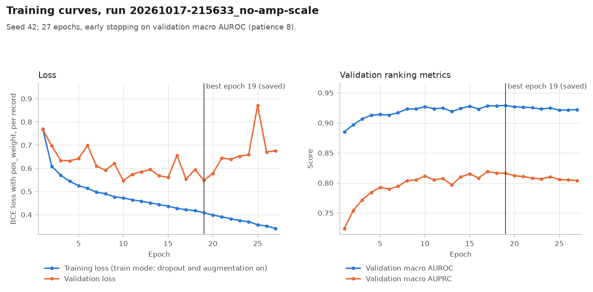

# Model and training

> Educational course project. Screening aid, not a diagnostic device. Not for clinical use.

This document describes the 1D ResNet, the training loop and how runs are recorded. For a short
overview, see the [README](../README.md#model-architecture). Results are in
[EXPERIMENTS_AND_RESULTS.md](EXPERIMENTS_AND_RESULTS.md).

## 1. Why a 1D CNN

An ECG record here is 12 parallel time series of 1000 samples each. A **one-dimensional
convolutional neural network (1D CNN)** slides small filters along the time axis of all 12 leads at
once.

- In principle, early filters can respond to short local shapes, such as the steep upstroke of a QRS
  complex.
- Deeper layers can combine those responses into longer patterns, such as a widened QRS or an
  ST-segment shift.
- The same filters are applied at every time position, so a pattern can be detected roughly wherever
  it occurs in the 10 s window. Strided layers and zero padding make this approximate, not exact.

This is the design intent. The project did not inspect what its filters actually learned.

A residual CNN is a standard strong model for fixed-length ECG classification (for example
Ribeiro et al., 2020; Strodthoff et al., 2021). Its global-average-pooling head also makes Grad-CAM
exact: Grad-CAM then reduces to the original class activation map, CAM
([EXPLAINABILITY.md](EXPLAINABILITY.md#4-why-this-is-exact-cam)).

## 2. Architecture

Defined in [`src/models/resnet1d.py`](../src/models/resnet1d.py); every size comes from the
`model` section of the config. `python -m src.models.resnet1d` prints the same parts, output shapes
(with a leading batch dimension of 1) and parameter counts.

| Part | Layers | Output shape (channels × time) | Parameters |
|---|---|---|---:|
| Input | 12 leads, 1000 samples | 12 × 1000 | |
| Stem | Conv1d(12→64, kernel 7, stride 2) → BatchNorm → ReLU → MaxPool(3, stride 2) | 64 × 250 | 5,504 |
| Stage 1 | 2 residual blocks, 64 channels, stride 1 | 64 × 250 | 82,432 |
| Stage 2 | 2 residual blocks, 128 channels, stride 2 | 128 × 125 | 295,936 |
| Stage 3 | 2 residual blocks, 256 channels, stride 2 | 256 × 63 | 1,181,696 |
| Stage 4 | 2 residual blocks, 512 channels, stride 2 | 512 × 32 | 4,722,688 |
| Head | Global average pooling over time → Dropout(0.3) → Linear(512→5) | 5 logits | 2,565 |
| **Total** | | | **6,290,821** |

**Residual block.** `Conv1d(k=5) → BatchNorm → ReLU → Dropout(0.2) → Conv1d(k=5) → BatchNorm`,
added to a skip path, then ReLU. The skip path is the identity, or a 1×1 convolution when the block
changes the channel count or the stride.

The skip path lets each block learn a *correction* to its input instead of a whole new
representation. This keeps gradients flowing through deep networks and makes them easier to train
(He et al., 2016).

**From features to predictions.** Stage 4 produces 512 feature channels at 32 time positions.
Global average pooling averages each channel over time, giving one 512-number summary of the record.
A single linear layer turns that summary into five numbers, the **logits**, one per class.

- The model outputs logits, not probabilities. A sigmoid is applied per class outside the model:
  inside `BCEWithLogitsLoss` during training, and SciPy's `expit` on float64 logits at evaluation,
  followed by the per-class calibrator.
- There is no softmax, because a record can have several classes at once.

**Choices the spec left open.** The spec names a max pool after the stem without a size: kernel 3,
stride 2 is taken from ResNet (He et al., 2016). It also puts a dropout inside each block without a
rate: 0.2 is the dropout rate (keep probability 0.8) in the code released with Ribeiro et al.
(2020), applied after the first ReLU of each residual unit. Both are starting values, not tuned.

## 3. Loss: weighted binary cross-entropy

Training uses `BCEWithLogitsLoss`: each of the five outputs is scored as its own yes/no question
with binary cross-entropy (BCE).

The classes are imbalanced: in the training split HYP is present in only 12% of records. Without a
correction, the model could score well by rarely predicting HYP. `pos_weight` up-weights each
positive label by negatives ÷ positives in the training split:

| Class | NORM | MI | STTC | CD | HYP |
|---|---:|---:|---:|---:|---:|
| Training positives (of 17,084) | 7,596 | 4,379 | 4,186 | 3,907 | 2,119 |
| `pos_weight` | 1.25 | 2.90 | 3.08 | 3.37 | 7.06 |

A side effect is that raw probabilities overstate every class. This is corrected after training
by calibration, see [CALIBRATION_AND_EVALUATION.md](CALIBRATION_AND_EVALUATION.md#4-why-the-raw-outputs-need-calibration).

## 4. Optimiser and learning-rate schedule

| Setting | Value | Purpose |
|---|---|---|
| Optimiser | AdamW | Adam with decoupled weight decay |
| Learning rate | 1e-3 | Peak learning rate |
| Weight decay | 1e-2, on every parameter | Keeps weights small to reduce overfitting |
| Warmup | Linear over the first 2 epochs (534 steps) | Avoids large, unstable updates at the start, while the weights are still random |
| Decay | Cosine from the peak to 0 at epoch 50, updated every step | Smaller steps later in training |
| Batch size | 64 | Fits a 4 GB GPU |
| Maximum epochs | 50 | |

The schedule always spans 50 epochs. A run that stops early therefore stops part-way down the
cosine curve.

## 5. Model selection and early stopping

- After every epoch, the model is scored on the **validation split (fold 9)** with macro AUROC (the
  mean of the five per-class AUROCs; see the [README](../README.md#how-to-read-the-metrics)).
- An epoch is a new best only if its macro AUROC is strictly higher than the previous best.
- Only the best epoch's weights are kept, in `checkpoints/<run_id>/best.pt`. The file is written to a
  temporary name and then renamed, so a crash cannot leave a half-written checkpoint.
- Training stops after 8 epochs without a new best, or at epoch 50.

Because the epoch is chosen on fold 9, fold-9 scores are slightly optimistic. Fold 10 is not used.

## 6. Run records

Every run writes two files to `reports/runs/` and refuses to overwrite an existing run id.

| File | Contents |
|---|---|
| `<run_id>.csv` | One row per epoch: learning rate, training and validation loss, validation macro and per-class AUROC and AUPRC, a best-epoch marker, plus the run id, git commit, dirty flag and seed on every row |
| `<run_id>.json` | The effective config, the `--set` overrides, git commit and dirty flag, seed, `pos_weight`, environment (Python, PyTorch, CUDA, GPU), data hashes, the best epoch and its metrics, status (`running`, `completed` or `failed`) |

The run id is `<YYYYMMDD-HHMMSS>_<name>`. The checkpoint (about 25 MB) stores the weights, the
config, the class and lead order, the epoch, git state, seed, `pos_weight`, validation metrics and
the cache hash. Training checkpoints are **not committed to git** (`checkpoints/` is in `.gitignore`); the one
exception is the frozen release model, `checkpoints/release.pt`, and its config, so a fresh clone can run the app.

## 7. Reproducibility

- One seed (`training.seed`, 42) drives the weight initialisation, shuffling, augmentation and
  dropout.
- cuDNN and cuBLAS run in deterministic mode (`training.deterministic: true`), which costs some
  speed.
- On the same machine and software stack, with the same `dataloader.num_workers`, the same code,
  config and seed give the same weights.
- **Determinism check.** The seed-42 "scaling on" run was repeated from a later commit with the
  same `src/` code and effective config (`20261017-223546_on-s42-repro`). All 27 epochs' metrics and
  the best checkpoint's weights matched the original bit for bit.
- Deterministic kernels do not make results identical across different GPUs, or between GPU and
  CPU. A model retrained elsewhere will be close to the committed reports, but not identical.

## 8. Overfit sanity check

`python -m src.training.train --overfit` checks that the model can learn at all. It trains on
50 training records (augmentation off) for 300 steps, with the same model, loss and optimiser as a
full run and the warmup-plus-cosine schedule stretched over its 300 steps. It passes if the final
eval-mode loss is at most 0.01.

Committed result (`reports/runs/20261017-215018_overfit.json`):

| Measure | Value |
|---|---|
| Training loss, first epoch (train mode) | 1.008 |
| Final training loss, train mode (dropout on) | 0.00019 |
| Final training loss, eval mode | 0.00004 |
| Labels correct at probability 0.5 | 250 of 250 (50 records × 5 classes) |
| Time for the 300-step loop | 12.5 s |

Memorising 50 records catches gross errors, such as wrong targets or a broken update step. The 50
records fit in one batch, so the check does not exercise augmentation, multi-batch epochs, the
validation pass, early stopping or checkpoint selection.

## 9. Training curves



For the committed run (`20261017-215633_no-amp-scale`, seed 42):

- Validation loss is lowest at epoch 10 (0.547) and back at 0.548 at the saved epoch 19.
- After epoch 19 the validation loss rises to between 0.58 and 0.87 while the training loss keeps
  falling. Validation macro AUROC falls from 0.929 at epoch 19 to between 0.921 and 0.927.
- The model becomes more confident without ranking records better, the usual first sign of
  overfitting. Early stopping ends the run at epoch 27.
- The losses include `pos_weight`, so they are not directly comparable with an unweighted BCE.

The run took 311 s for 27 epochs (about 11.5 s per epoch) on a 4 GB laptop GPU. The other seeds
stopped earlier, after 22 and 21 epochs, with best epochs 14 and 13.

## 10. Command-line reference

```text
python -m src.training.train [--config PATH] [--name NAME] [--set KEY=VALUE ...] [--overfit]
```

| Flag | Meaning |
|---|---|
| `--name NAME` | Run name (letters, digits, `-`, `_`); default `main`. Ignored by `--overfit` |
| `--set KEY=VALUE` | Override one config value for this run, for example `--set training.seed=43`. Repeatable. The key must exist and keep its type, and `splits.*` cannot be changed. Not accepted with `--overfit` |
| `--overfit` | Run the 50-record sanity check instead of a full run |
| `--config PATH` | Use another config file |

`bash scripts/run_training.sh [train arguments]` chains the GPU test, the overfit check and a full
run, and stops at the first failure. It needs a CUDA GPU, because it starts with
`tests/test_cuda.py`, and a bash shell (on Windows, Git Bash or WSL).

**Training without a GPU.** `training.device` is `cuda` by default, and training refuses to start
if PyTorch cannot see a GPU, rather than silently falling back to the CPU. Set
`training.device: cpu` in the config to use the CPU for every command (see the
[README](../README.md#4-only-without-an-nvidia-gpu-use-the-cpu)). For a full training run alone,
`--set training.device=cpu` also works; `--overfit`, the evaluation and the Grad-CAM commands do not
accept `--set`. A CPU run is much slower and has not been timed.

## 11. Committed runs

All runs below were trained from a clean git tree; their records are in `reports/runs/`. Scores are
validation (fold 9) macro values at the best epoch.

| Run id | Seed | Amplitude scaling | Epochs | Best epoch | Macro AUROC | Macro AUPRC |
|---|---:|---|---:|---:|---:|---:|
| `20261017-215018_overfit` | 42 | (off, sanity check) | 300 steps | – | – | – |
| `20261017-215053_main` | 42 | on | 27 | 19 | 0.9274 | 0.8116 |
| `20261017-215633_no-amp-scale` | 42 | off | 27 | 19 | **0.9290** | **0.8162** |
| `20261017-223546_on-s42-repro` | 42 | on | 27 | 19 | 0.9274 | 0.8116 |
| `20261017-224554_on-s43` | 43 | on | 22 | 14 | 0.9270 | 0.8120 |
| `20261017-224121_off-s43` | 43 | off | 22 | 14 | 0.9272 | 0.8117 |
| `20261017-225446_on-s44` | 44 | on | 21 | 13 | 0.9268 | 0.8127 |
| `20261017-225026_off-s44` | 44 | off | 21 | 13 | 0.9276 | 0.8164 |

- `20261017-215633_no-amp-scale` uses the committed config and is the model evaluated in
  [CALIBRATION_AND_EVALUATION.md](CALIBRATION_AND_EVALUATION.md) (`evaluation.model_run`).
- The run named `main` is the **scaling-on** arm: amplitude scaling was on by default when it was
  trained. Since then the config has scaling off, so a new `--name main` run today trains the
  scaling-off configuration and should match `no-amp-scale`, not the committed `main`.

## References

- He, K., Zhang, X., Ren, S., & Sun, J. (2016). Deep residual learning for image recognition.
  *CVPR 2016*, 770–778.
- Ribeiro, A. H., Ribeiro, M. H., Paixão, G. M. M., et al. (2020). Automatic diagnosis of the 12-lead
  ECG using a deep neural network. *Nature Communications*, 11, 1760.
- Strodthoff, N., Wagner, P., Schaeffter, T., & Samek, W. (2021). Deep learning for ECG analysis:
  Benchmarks and insights from PTB-XL. *IEEE Journal of Biomedical and Health Informatics*, 25(5),
  1519–1528.
